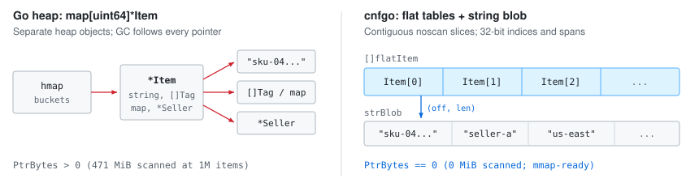
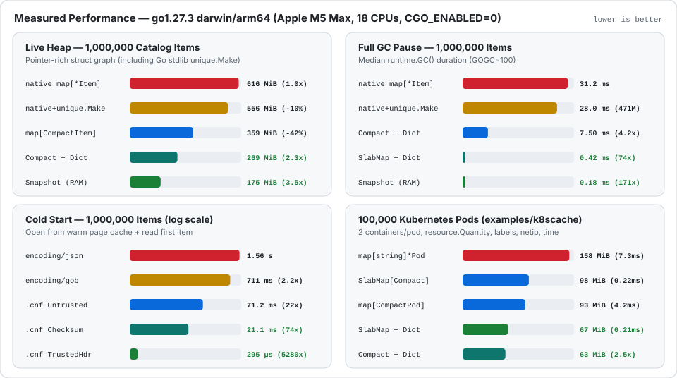

# cnfgo

[](https://pkg.go.dev/github.com/Voskan/cnfgo)

`cnfgo` is a code generator and runtime library that compiles ordinary Go types into pointer-free (`noscan`) memory arenas, 16-byte compact values, zero-relocation `mmap` files, and concurrent caches with minimal garbage collector overhead. It targets Go 1.26+ with `CGO_ENABLED=0` and has no external dependencies.

Long-lived in-memory state in Go (routing tables, Kubernetes informers, policy bundles, catalog caches, feature stores) pays two recurring runtime costs: every `*T`, `string`, `[]T`, and `map` header on the live heap is traced on each GC mark cycle, and loading large snapshots through `encoding/json` or `encoding/gob` allocates millions of heap objects on startup. Interning strings with `unique.Make` deduplicates backing bytes while leaving every struct pointer, string header, slice header, and map bucket on the collector's scan path.

`cnfgo` inspects existing Go structs with `go/types` and generates type-safe, immutable `View` and `Compact<T>` types backed by flat slices with `PtrBytes == 0` and contiguous byte buffers. No `.proto` or `.fbs` schema files are needed, and generated `*_cnf.gen.go` files do not import `unsafe` (all low-level operations stay inside `cnfrt` and `unsafemmap`).

<picture>
  <source media="(prefers-color-scheme: dark)" srcset="docs/assets/layout-dark.svg">
  <source media="(prefers-color-scheme: light)" srcset="docs/assets/layout-light.svg">
  
</picture>

## Install

```bash
go get github.com/Voskan/cnfgo@latest
go get -tool github.com/Voskan/cnfgo/cmd/cnfgo@latest
```

## Quick start

Define your Go types as usual and add a `//go:generate` directive:

```go
package policy

import (
	"net/netip"
	"time"
)

//go:generate go tool cnfgo -type=Bundle -compact=Route

type Bundle struct {
	Revision string
	Built    time.Time
	Routes   map[string]*Route         `cnf:",hash"` // O(1) wyhash table in the snapshot
	IPLists  map[string][]netip.Prefix               // sorted map + packed prefix pool
}

type Route struct {
	Host     string
	Policies []*Policy // shared *Policy pointers are deduplicated
}

type Policy struct {
	ID      string
	Enabled bool
	Match   []Matcher
}

// Closed sum type encoded as (VariantTag, NodeID) without interface boxing.
//
//cnf:implementations=PathPrefix,SourceIn,*Not
type Matcher interface{ isMatcher() }
```

Running `go generate ./...` produces `bundle_cnf.gen.go`. Depending on how the data is updated and queried, you can use whole-graph snapshots, per-item compact values, or standalone pointer-free maps.

### 1. Snapshots and `mmap` files

`FreezeBundle` packs an object graph (trees, shared DAGs, or cyclic graphs via `FreezeCyclic<T>`) into typed `[]flatT` slices (`PtrBytes == 0`) and a deduplicated string buffer. The same byte layout can be written to disk as a 64-byte-aligned `.cnf` file and mapped back with `MAP_PRIVATE`:

```go
snap, err := FreezeBundle(liveBundle)
if err != nil {
	return err
}

if route, ok := snap.Root().Routes().Get("api.example.com"); ok {
	for p := range route.Policies().All() {
		if p.Enabled() && p.IDEquals("global-deny-list") {
			// Compares bytes in place without allocating a Go string.
		}
	}
}

// Atomic write: temp file -> fsync -> rename -> parent dir fsync.
if err := WriteBundleSnapshotAtomic("bundle.cnf", snap); err != nil {
	return err
}

mapped, err := MapBundleFile("bundle.cnf", cnfrt.VerifyTrustedHeader)
if err != nil {
	return err
}
defer mapped.Close()

// Optional SIGBUS guard if another process can truncate the file while mapped.
err = mapped.WithRootFaultSafe(func(root BundleView) error {
	_, _ = root.Routes().Get("api.example.com")
	return nil
})
```

### 2. 16-byte `Compact<T>` values and shared `cnfrt.Dict`

`-compact=Pod` generates `CompactPod`, a 16-byte immutable value (`struct{ cnfRaw string }`) that can be stored directly in a standard Go `map`, slice, or channel. Passing a bounded `cnfrt.Dict` interns repeated strings (such as namespaces, image names, and label keys) across values, while an atomic seen-twice filter skips one-off strings like UIDs:

```go
dict := cnfrt.NewDict(cnfrt.DefaultDictMaxBytes) // 32 MiB budget, PtrBytes == 0 index
defer dict.Close()

cache := make(map[string]CompactPod, 100_000)
for _, pod := range pods {
	c, err := PackPod(pod, cnfrt.WithDict(dict))
	if err != nil {
		return err
	}
	cache[pod.Namespace+"/"+pod.Name] = c
}

c := cache["team-1/svc-1-00000001"]
ns, ip, start := c.Namespace(), c.PodIP(), c.StartTime() // 0 allocs

// View decodes nested collections and sub-structs in place (1 header alloc):
cpu, err := c.View().Containers().At(0).Resources().CPULimit()

// TryView returns an error instead of panicking if Dict was closed or data is invalid.
if v, err := c.TryView(); err == nil {
	_ = v.Labels().Len()
}

// Materialize dictionary strings locally before writing raw bytes to disk or network.
standalone, err := c.Detach()
```

### 3. Mutable off-GC cache with `SlabMap`

A `map[K]Compact<T>` still keeps one string header pointer per entry on the scanned heap. `cnfrt.SlabMap[K, V]` removes that scan cost as well by storing entries in 64 cache-line-padded shards backed by `PtrBytes == 0` hash slots and self-compacting byte slabs:

```go
slabs, err := cnfrt.NewSlabMap[string, CompactPod](nil)
if err != nil {
	return err
}
_ = slabs.Put("team-1/api-01", standalone)

var podIP netip.Addr
found := slabs.Borrow("team-1/api-01", func(raw []byte) {
	if c, err := BorrowCompactPodBytes(raw); err == nil {
		podIP = c.PodIP()
	}
})
```

### 4. Read-mostly concurrent cache with `TieredMap`

`tiered.TieredMap[K, V]` combines an immutable `cnfrt.FrozenMap` base (`PtrBytes == 0`) with 64 mutable delta shards and background compaction. When the active delta layer has no uncompacted writes, `Get` reads from the `FrozenMap` base through a single atomic pointer load without acquiring locks:

```go
tm, err := tiered.New[string, CompactPod](nil)
if err != nil {
	return err
}
defer tm.Close()

tm.Put("team-1/api-01", standalone)
_ = tm.Flush() // rebuilds base; rotations also run automatically at threshold

if c, ok := tm.Get("team-1/api-01"); ok {
	_ = c.PodIP()
}
```

### 5. Standalone `FrozenMap` without code generation

`cnfrt.FrozenMap` and `unsafemmap.OpenFrozenMap` work directly on built-in types (`string`, integers, floats, `netip.Addr`, `netip.Prefix`, `time.Time`) as well as generated `Compact<T>` values:

```go
fm, err := cnfrt.NewFrozenMap(map[netip.Addr]uint32{
	netip.MustParseAddr("10.0.1.10"): 1001,
	netip.MustParseAddr("10.0.1.11"): 1002,
}, nil)
if err != nil {
	return err
}

if err := cnfrt.WriteSnapshotAtomic("peers.cnf", func(w io.Writer) error {
	_, err := fm.WriteTo(w)
	return err
}); err != nil {
	return err
}

mappedFM, mapping, err := unsafemmap.OpenFrozenMap[netip.Addr, uint32]("peers.cnf", cnfrt.VerifyTrustedHeader, nil)
if err != nil {
	return err
}
defer mapping.Close()

_ = mappedFM.WithFaultSafe(func(m *cnfrt.FrozenMap[netip.Addr, uint32]) error {
	asn, ok := m.Get(netip.MustParseAddr("10.0.1.10"))
	_, _ = asn, ok
	return nil
})
```

## Primitives

| Primitive | Mutability | RAM (1M items) | Scanned heap (1M) | Point read | Persistence | Typical use |
| :--- | :--- | :--- | :--- | :--- | :--- | :--- |
| `Snapshot` (`Freeze<T>`) | Immutable | 175 MiB (vs 616 MiB) | 0.0 MiB (0.18 ms GC) | 70 ns | `.cnf` / `io.WriterTo` | Config and policy bundles, routing tables, atomic graph swaps |
| `.cnf` + `unsafemmap` | Immutable | 0.1 MiB Go heap + 175 MiB `mmap` | 0.0 MiB (0.18 ms GC) | 72 ns | `MAP_PRIVATE` file | Fast cold start (295 µs from page cache), shared host pages |
| `Compact<T>` (`+ Dict`) | Immutable value | 269-359 MiB | 53.3 MiB (1 ptr/entry) | 62-72 ns | `Detach()` + `Raw()` | Value replacement for `*T` in standard Go maps, slices, channels |
| `SlabMap[K, V]` (`+ Dict`) | Mutable (`Put`/`Delete`) | 278-366 MiB | 0.2 MiB (0.42-0.45 ms GC) | 154-168 ns (`Borrow`) | In-memory | Mutable KV caches under container memory limits |
| `FrozenMap[K, V]` | Immutable | Contiguous arrays | 3 slice headers | 12.6 ns (`string`) | `.cnf` / `OpenFrozenMap` | Read-only lookup tables in RAM or mapped from disk |
| `TieredMap[K, V]` | Mutable (`Put`/`Delete`) | Compact base + delta | Delta layer only (0.15 ms GC) | 0.85 ns (hot) | `Flush()` -> `Base()` | Read-heavy concurrent caches with periodic or trickle writes |

### When not to use `cnfgo`

* Small heaps or short-lived request data: if live state is a few megabytes or allocated per request, ordinary Go pointers are simpler and fast enough.
* Unconstrained memory with no cold-start budget: if a process has plenty of free RAM and no container `GOMEMLIMIT`, raising `GOGC=400` reduces collection frequency without changing data structures (included in the benchmark tables below).
* Cross-language wire protocols: `.cnf` is a deterministic, endian-portable format keyed to Go types via `SchemaHash`. If services written in Rust, C++, or Python need to decode the same payload, use Protocol Buffers or FlatBuffers.

## Benchmarks

Each row in [`benchmarks/cmd/report`](benchmarks/cmd/report) runs in a separate child OS process so heap and GC metrics do not leak between runs:

```bash
go run ./benchmarks/cmd/report -n 100000,1000000 -cold 1000000 -highcard 1000000
```

<picture>
  <source media="(prefers-color-scheme: dark)" srcset="docs/assets/benchmarks-dark.svg">
  <source media="(prefers-color-scheme: light)" srcset="docs/assets/benchmarks-light.svg">
  
</picture>

Environment: `go1.27.3` on `darwin/arm64` (Apple M5 Max, 18 CPUs, `CGO_ENABLED=0`, `GOGC=100` unless noted). Each catalog `Item` holds 3 strings, a slice, a `map[string]string`, a `time.Time`, an inlined nested struct, and a pointer to one of 1,000 shared `Seller`s. Heap is live object bytes held by the store; Scanned heap is `/gc/scan/heap:bytes`; Full GC is the median of 5 `runtime.GC()` calls; Point read looks up a random key and reads `Price` plus `Title` bytes (`WithTitle` on `snapshot-mmap` avoids cloning; `Title()` copies the string so it remains safe after `Close`); Churn allocates 2 GiB of short-lived request objects while the store stays live and records `/cpu/classes/gc/total:cpu-seconds`.

### 1,000,000 catalog items

| Scenario | Build | Heap | Off-heap | Scanned heap | Full GC | Point read | Churn GC cycles | Churn GC CPU |
| :--- | --: | --: | --: | --: | --: | --: | --: | --: |
| native `map[uint64]*Item` | - | 616.0 MiB | - | 471.0 MiB | 31.19 ms | 61 ns | 3 | 862 ms |
| native + `unique.Make[string]` | - | 556.1 MiB | - | 471.0 MiB | 27.97 ms | 43 ns | 4 | 1.03 s |
| native, `GOGC=400` (unbounded RAM) | - | 616.0 MiB | - | 471.0 MiB | 31.43 ms | 59 ns | 0 | 0 ns |
| native, `GOGC=400` + `GOMEMLIMIT` (1.5x + 64 MiB) | - | 616.0 MiB | - | 471.0 MiB | 31.20 ms | 60 ns | 10 | 2.75 s |
| `map[uint64]CompactItem` | 945 ms | 358.6 MiB | - | 53.3 MiB | 10.10 ms | 62 ns | 5 | 197 ms |
| `map[uint64]CompactItem` + `Dict` | 936 ms | 269.4 MiB | - | 53.3 MiB | 7.50 ms | 72 ns | 7 | 241 ms |
| `SlabMap[uint64, CompactItem]` (`Get`) | 1.00 s | 365.9 MiB | - | 0.2 MiB | 0.45 ms | 207 ns | 6 | 15.2 ms |
| `SlabMap[uint64, CompactItem]` (`Borrow`) | 996 ms | 366.1 MiB | - | 0.2 MiB | 0.44 ms | 168 ns | 5 | 13.1 ms |
| `SlabMap[uint64, CompactItem]` + `Dict` (`Get`) | 1.05 s | 277.8 MiB | - | 0.2 MiB | 0.43 ms | 235 ns | 8 | 20.4 ms |
| `SlabMap[uint64, CompactItem]` + `Dict` (`Borrow`) | 1.04 s | 277.9 MiB | - | 0.2 MiB | 0.42 ms | 154 ns | 7 | 17.0 ms |
| `Snapshot` in RAM (`FreezeCatalog`) | 819 ms | 174.7 MiB | - | 0.0 MiB | 0.18 ms | 70 ns | 11 | 24.2 ms |
| `Snapshot` mapped from `.cnf` | 869 ms | 0.1 MiB | 174.6 MiB | 0.0 MiB | 0.18 ms | 72 ns | 187 | 357 ms |

### High-cardinality strings (1,000,000 items, 100% unique `Title` and `SKU`)

In this workload every item has a distinct `Title` and `SKU` (zero title sharing across 1,000,000 records):

| Scenario | Build | Heap | Scanned heap | Full GC | Point read | Churn GC cycles | Churn GC CPU |
| :--- | --: | --: | --: | --: | --: | --: | --: |
| native `map[uint64]*Item` | - | 631.3 MiB | 471.0 MiB | 31.08 ms | 57 ns | 3 | 777 ms |
| `map[uint64]CompactItem` | 925 ms | 358.6 MiB (-43%) | 53.3 MiB | 10.07 ms | 60 ns | 5 | 191 ms |
| `map[uint64]CompactItem` + `Dict` | 949 ms | 329.2 MiB (-48%) | 53.3 MiB | 9.11 ms | 62 ns | 6 | 226 ms |
| `SlabMap[uint64, CompactItem]` (`Borrow`) | 1.06 s | 372.0 MiB (-41%) | 0.2 MiB | 0.44 ms | 198 ns | 5 | 13.1 ms |
| `Snapshot` in RAM (`FreezeCatalog`) | 941 ms | 220.8 MiB (2.86x smaller) | 0.0 MiB | 0.18 ms | 92 ns | 9 | 19.4 ms |

Removing pointer, slice, and map headers still cuts heap usage by 41-65%, and `cnfrt.Dict`'s seen-twice filter rejects the 2,000,000 unique `Title` and `SKU` strings on first sight instead of filling dictionary capacity.

### 100,000 catalog items

| Scenario | Build | Heap | Scanned heap | Full GC | Point read | Churn GC cycles | Churn GC CPU |
| :--- | --: | --: | --: | --: | --: | --: | --: |
| native `map[uint64]*Item` | - | 60.4 MiB | 45.8 MiB | 3.24 ms | 25 ns | 31 | 655 ms |
| native + `unique.Make[string]` | - | 55.8 MiB | 45.8 MiB | 2.87 ms | 18 ns | 34 | 752 ms |
| native, `GOGC=400` (unbounded RAM) | - | 60.4 MiB | 45.8 MiB | 3.02 ms | 21 ns | 7 | 144 ms |
| native, `GOGC=400` + `GOMEMLIMIT` (1.5x + 64 MiB) | - | 60.4 MiB | 45.8 MiB | 3.05 ms | 21 ns | 40 | 847 ms |
| `map[uint64]CompactItem` | 82 ms | 33.9 MiB | 3.4 MiB | 1.20 ms | 28 ns | 48 | 277 ms |
| `map[uint64]CompactItem` + `Dict` | 88 ms | 27.2 MiB | 3.4 MiB | 0.92 ms | 34 ns | 57 | 346 ms |
| `SlabMap[uint64, CompactItem]` (`Borrow`) | 91 ms | 45.4 MiB | 0.1 MiB | 0.22 ms | 66 ns | 38 | 78 ms |
| `SlabMap[uint64, CompactItem]` + `Dict` (`Borrow`) | 96 ms | 36.1 MiB | 0.1 MiB | 0.23 ms | 69 ns | 45 | 87 ms |
| `Snapshot` in RAM (`FreezeCatalog`) | 56 ms | 18.1 MiB | 0.0 MiB | 0.19 ms | 16 ns | 72 | 133 ms |

### Cold start and package microbenchmarks

```bash
go test -run=^$ -bench=. -benchmem ./cnfrt ./tiered ./benchmarks
```

| Benchmark | Result |
| :--- | :--- |
| Cold start (1,000,000 items, warm page cache to first read): `json` (337 MiB) / `gob` (190 MiB) / `.cnf TrustedHeader` (174.6 MiB) / `.cnf Checksum` / `.cnf Untrusted` | 1.56 s / 711 ms / 295 µs / 21.1 ms / 71.2 ms |
| `FreezeCatalog` build cost: 100,000 items (18.0 MiB) / 1,000,000 items (174.6 MiB) | 65 ms (38 allocs, 48.1 MiB peak) / 905 ms (46 allocs, 267.6 MiB peak) |
| `examples/k8scache` (100,000 K8s Pods): `map[*Pod]` / `map[CompactPod]` / `map[CompactPod]+Dict` / `SlabMap` / `SlabMap+Dict` | Heap 158.0 / 92.7 / 63.4 / 98.1 / 67.3 MiB; Full GC 7.29 / 4.23 / 3.42 / 0.22 / 0.21 ms |
| `tiered.BenchmarkParallelReadHot` (1M keys, 1024 hot keys, 18 CPUs): `TieredMap` / `sync.Map` / sharded `RWMutex` map | 0.85 / 1.83 / 7.85 ns/op (0 B/op, 0 allocs/op) |
| `tiered.BenchmarkMixed` (1M `uint64->uint64`, 95% reads, 18 CPUs): `TieredMap` / `sync.Map` / sharded `RWMutex` map | 35.4 / 11.5 / 24.2 ns/op (p99 4.6 / 0.6 / 8.7 µs) |
| `tiered.BenchmarkGC/String` (1M `string->string`, compacted base): `TieredMap` / `sync.Map` / sharded `RWMutex` map | 0.15 ms / 23.8 ms / 5.16 ms |
| `cnfrt.BenchmarkFrozenMapGetString` (`string` lookup, 18 CPUs) | 12.6 ns/op (0 B/op, 0 allocs/op) |
| `cnfrt.BenchmarkSlabMapGet` / `BenchmarkSlabMapParallel` (5% writes, 18 CPUs) | 19.9 ns/op (0 allocs/op) / 22.1 ns/op |
| `benchmarks.BenchmarkPack` (`CompactItem`, pooled builder): standalone / `WithDict` | 479 ns (320 B/op, 1 alloc/op) / 494 ns (208 B/op, 1 alloc/op) |
| `examples/policybundle` (20,000 hosts, 29.5 MiB `.cnf`): reopen with `VerifyTrustedHeader` | 13 µs median (197 µs first open in process) |

### Notes on the results

* `unique.Make[string]`: interning repeated strings in standard Go saves 60 MiB of duplicate string bytes (616 -> 556 MiB), but every `*Item`, slice header, and `map[string]string` bucket still holds pointers (471 MiB scanned heap), and maintaining the weak-pointer interning table increases churn GC CPU from 862 ms to 1.03 s.
* `GOGC=400` vs `GOMEMLIMIT`: with unbounded RAM, `GOGC=400` lets the heap grow large enough to skip collections during a 2 GiB burst. Under a container memory limit (`GOMEMLIMIT` set to 1.5x live heap + 64 MiB), forced cycles trace all 471 MiB of pointers and spend 2.75 s of GC CPU, compared with 24.2 ms for `Snapshot` and 13.1-20.4 ms for `SlabMap`.
* Two-pass `Freeze`: Pass 1 uses a bounded 16 MiB `PtrBytes == 0` hash cache to size node tables and deduplicated strings (~100 MiB of source strings collapse into a 14 MiB blob allocated once in Pass 2), completing a 1,000,000-item freeze in 46 heap allocations.
* `SlabMap` sizing and alignment: each of the 64 shards grows slabs from 4 KiB up to 256 KiB, which can leave up to 16 MiB of active-slab slack. `SlabMap` respects `AlignedCodec` (8-byte alignment for `Compact<T>`), so `Borrow` + `BorrowCompact<T>Bytes` avoids alignment-copy allocations even when `c.View()` is called.
* Mapped `.cnf` files and `GOGC`: an `mmap` snapshot places 0.1 MiB on the Go heap, so default `GOGC=100` without a `GOMEMLIMIT` keeps the GC trigger near its 4 MiB floor during heavy allocation churn (187 short cycles). Set `GOMEMLIMIT` or a higher `GOGC` when serving request traffic alongside `mmap` snapshots. Cold-start numbers (295 µs) measure opening a file already in the OS page cache and reading the first record; uncached disk latency depends on storage I/O as pages fault in.
* `TieredMap` vs `sync.Map`: `sync.Map` has lower latency under continuous mixed writes across disjoint keys, whereas `TieredMap` is faster on hot concurrent reads (0.85 ns/op vs 1.83 ns/op) and keeps its compacted base off the GC scan path (0.15 ms vs 23.8 ms on 1M strings; under active writes, up to `base/16` entries sit in the scanned delta layer until rotation).

## Design overview

Full byte layouts, concurrency proofs, and safety invariants are documented in [`docs/ARCHITECTURE.md`](docs/ARCHITECTURE.md). Key mechanics:

1. Value-struct inlining (`cnfgo/schema/v3`): non-root structs used exclusively by value outside recursive cycles with flat size `<= 128` bytes are embedded directly as `flat<S>` inside parent records, `flatKV` entries, and `[]flat<S>` pools instead of allocating separate `NodeID` tables. Larger value structs stay in node tables so `View` values remain small.
2. Single-copy `Compact<T>` (`0x03`): `Compact<T>` wraps a single `cnfRaw string`. The flat root record is stored once at byte offset 1, allowing scalar root getters to inline with at most 1 bounds check and string root getters to read local spans with at most 1 bounds check (at most 2 for `time.Time` and `netip.Addr`), with zero heap allocations. Non-empty child sections follow a presence bitmask in descending alignment order (`8 -> 4 -> 2 -> 1`) and end with a Castagnoli `CRC32C`.
3. Shared `noscan` dictionary (`cnfrt.Dict`): repeated strings across `Compact<T>` values are stored in immutable chunks (up to 2 MiB each) indexed by a `PtrBytes == 0` hash table. Each dictionary carries an 8-byte `dictToken` (16-bit slot + 48-bit random nonce), so values resolve only against the dictionary instance that packed them; untrusted callers must opt in explicitly with `cnfrt.AllowDict`. Once full, chunk slices are trimmed to committed length and lookups run lock-free.
4. Verification modes (`cnfrt.VerifyMode`):
   * `VerifyTrustedHeader` checks the 64-byte header, `HeaderCRC32C`, `SchemaHash`, section directory `DirCRC32C`, alignment, and section bounds; OS pages fault in lazily.
   * `VerifyChecksum` adds `CRC32C` verification across every section payload.
   * `VerifyUntrusted` copies input into aligned private heap memory, verifies all checksums, checks every `NodeID`, `Span32`, `VariantTag`, location/zone index, linear hash-probe budget, and iterative flat-buffer graph acyclicity (`cnfrt.CheckAcyclic`) in $O(N)$ time, returning an `error` on malformed input without panicking.
5. Portability and lifecycle: flat struct sizes and field offsets match across 32-bit and 64-bit targets (`amd64`, `arm64`, `386`, `arm`, `riscv64`, `wasm`), using zero-copy slice casts on little-endian CPUs and an automatic `binary.Decode` path on big-endian targets (testable anywhere with `-tags cnfgo_portable`). `unsafemmap` pairs idempotent `Close()` with `runtime.AddCleanup`, and `cnfrt.LeakDetector` reports retained views or substrings pinning retired arenas.

## Supported types and flags

* Scalars and standard library types: `bool`, `int`/`uint` (normalized to 64-bit wire width), `int8`..`int64`, `uint8`..`uint64`, `float32`, `float64` (preserving `-0.0` and `NaN` bit patterns), `complex64`, `complex128`, `string`, `[]byte`, `time.Time` (UTC, IANA zones, named and unnamed fixed offsets, wall clock with monotonic stripped), `time.Duration`, `netip.Addr` (IPv4, IPv6, v4-in-v6, IPv6 zones), `netip.AddrPort`, `netip.Prefix`, and `k8s.io/apimachinery/pkg/api/resource.Quantity`.
* Composites and graphs: nested and embedded structs (accessed via explicit wrapper method, e.g. `v.Meta().ID()`), fixed arrays `[N]T` (including `[0]T` and named scalar arrays), slices `[]T` (`nil` preserved distinct from `[]T{}`), pointers `*T` (DAG deduplication by default, cycles via `FreezeCyclic<T>`), closed interfaces via `//cnf:implementations=A,B,*C`, defined types and aliases, and custom types via `cnfrt.Codec[T]`.
* Map keys: `string`, `bool`, integers, floats (`NaN` rejected with `ErrNaNKey`), `netip.Addr`, `netip.AddrPort`, `netip.Prefix`, fixed scalar arrays `[N]scalar`, and comparable flat structs. Default maps use sorted `flatKV` runs with binary search; `` `cnf:",hash"` `` builds an $O(1)$ seeded `wyhash` index; `` `cnf:"-"` `` skips a field.

| `cmd/cnfgo` flag | Description |
| :--- | :--- |
| `-type=A,B` | Root struct types; emits `Freeze<T>`, `FreezeTree<T>`, `FreezeCyclic<T>`, `Map<T>File`, `Write<T>SnapshotAtomic`, `WithRoot<T>FaultSafe`, and `Unmarshal<Snap>`. |
| `-compact=T` | Emits 16-byte `Compact<T>` with `Pack<T>`, `PackTree<T>`, `PackCyclic<T>`, `ParseCompact<T>`, `BorrowCompact<T>`, `BorrowCompact<T>Bytes`, `View`, `TryView`, `Detach`, and root field getters. |
| `-codec=pkg.Type=pkg.Adapter` | Registers a `cnfrt.Codec[T]` implementation (repeatable; supports generic `T` substitution such as `...=github.com/Voskan/cnfgo/cnfrt/codecs/k8s.Quantity[T,*T]`). |
| `-tree` | Treats object graphs as trees by default (skips visited-pointer table and root heap escape). |
| `-prefix=X` | Prefixes generated identifiers so multiple schemas can share one package. |
| `-out`, `-tags` | Output file path (`*_cnf.gen.go` by default) and build tags passed to `go/types` package loading. |

Reserved identifiers: generated types use unexported fields starting with `cnf` followed by an upper-case letter (`cnfSnap`, `cnfRaw`, ...), so user struct fields named `cnf` or `cnfX` are rejected; other unexported names (`id`, `raw`, `str`, `time`) are allowed. View getters must not collide with `IsValid`, `NodeID`, `Snapshot`, or `Unfreeze`, and `Compact<T>` root getters must not collide with `IsZero`, `UsesDict`, `Detach`, `Raw`, `Equal`, `View`, `TryView`, `Snapshot`, `Unpack`, `SizeCNF`, `AppendCNF`, `DecodeCNF`, `CodecCNF`, or `SchemaHashCNF`.

## Examples

Runnable programs in [`examples/`](examples):

```bash
go run ./examples/k8scache -pods 100000
go run ./examples/policybundle -hosts 20000
go run ./examples/meshnode -peers 20000
```

Output from `examples/k8scache`:

```text
caching 100000 pods (2 containers each, CPU and memory quantities)
  map[string]*Pod            heap   158.0 MiB, scannable   116.3 MiB, full GC   7.29ms
  map[string]CompactPod      heap    92.7 MiB, scannable     5.0 MiB, full GC   4.23ms
  SlabMap[string, CompactPod] heap    98.1 MiB, scannable     0.1 MiB, full GC    220µs
slab map: 100000 pods in 704 slabs, 85.5 MiB live
  map[string]CompactPod+Dict heap    63.4 MiB, scannable     5.0 MiB, full GC   3.42ms
  dict: 2270 shared strings, 0.05 MiB strings, 1.19 MiB total in 1 chunk(s)
  SlabMap+Dict               heap    67.3 MiB, scannable     0.1 MiB, full GC    210µs
slab+dict map: 100000 pods in 576 slabs, 56.5 MiB live
```

## Packages

* [`cmd/cnfgo`](cmd/cnfgo): `go/types` schema analyzer, flat layout planner, canonical schema hasher, and code generator.
* [`cnfrt`](cnfrt): runtime builder, `.cnf` and `Compact 0x03` codecs, `Dict`, `FrozenMap`, `SlabMap`, `time.Time` and `net/netip` codecs, `CheckAcyclic`, and `LeakDetector`.
* [`cnfrt/codecs/k8s`](cnfrt/codecs/k8s): `resource.Quantity` codec without `k8s.io/*` module dependencies.
* [`unsafemmap`](unsafemmap): read-only `MAP_PRIVATE` file mapping, endian-aware slice casting, `runtime.AddCleanup` unmapping, and `SIGBUS` fault recovery.
* [`tiered`](tiered): `TieredMap[K, V]` concurrent cache with lock-free clean reads, point-in-time `Snapshot()`, and background compaction.
* [`benchmarks`](benchmarks): isolated multi-process benchmark harness and microbenchmarks.
* [`docs/ARCHITECTURE.md`](docs/ARCHITECTURE.md): format specification and concurrency invariants.

## License

MIT. See [LICENSE](LICENSE).
