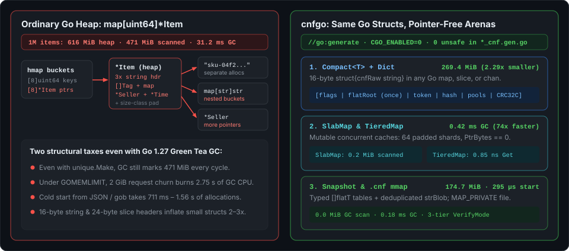
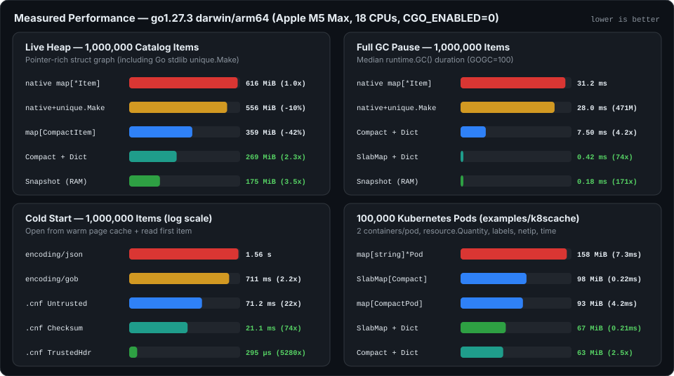
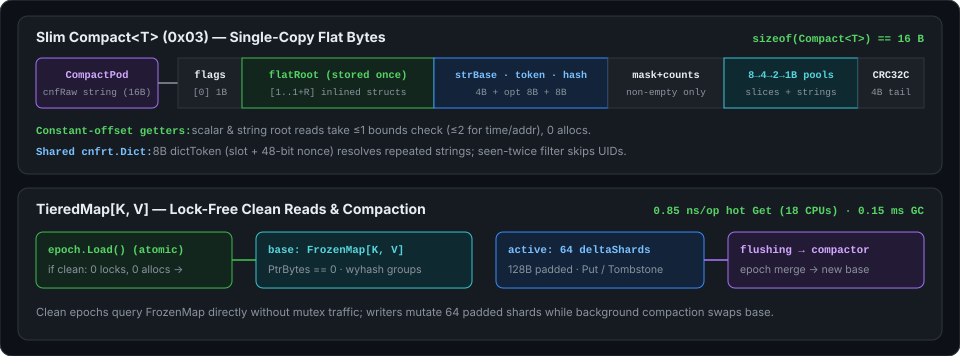

# cnfgo

**Compile ordinary Go types into pointer-free (`noscan`) memory arenas, 16-byte compact values, zero-relocation `mmap` snapshots, and zero-GC concurrent caches — with `//go:generate`, `CGO_ENABLED=0`, and zero external dependencies.**

[**Why `cnfgo`?**](#why-cnfgo) · [**30-Second Tour**](#30-second-tour) · [**Choosing a Primitive**](#choosing-a-primitive) · [**Benchmarks**](#benchmarks) · [**Under the Hood**](#under-the-hood) · [**Examples**](#runnable-examples) · [**Architecture**](docs/ARCHITECTURE.md)

| Footprint (`1M` structs) | Full GC Pause (`1M` structs) | Cold Start (`174.6 MiB` `.cnf`) | Hot Concurrent Read (`18` CPUs) | Toolchain & Safety |
| :---: | :---: | :---: | :---: | :---: |
| **`2.3× – 3.5×` smaller**<br><sub>`175–269 MiB` vs `616 MiB` native</sub> | **`74× – 171×` faster**<br><sub>`0.18–0.42 ms` vs `31.2 ms`</sub> | **`295 µs`** *(warm page cache)*<br><sub>vs `711 ms` `gob` / `1.56 s` `json`</sub> | **`0.85 ns/op`**<br><sub>`TieredMap` (`0 allocs/op`)</sub> | **`CGO_ENABLED=0` · `0` deps**<br><sub>`0` `unsafe` imports in `.gen.go`</sub> |

<p align="center">
  <picture>
    <source media="(prefers-color-scheme: dark)" srcset="docs/assets/memory-model-dark.svg">
    <source media="(prefers-color-scheme: light)" srcset="docs/assets/memory-model-light.svg">
    
  </picture>
</p>

---

## Why `cnfgo`?

Even with Go 1.26 and 1.27's page-oriented Green Tea collector, services that hold hundreds of megabytes or gigabytes of standing in-memory state — Kubernetes informers, routing tables, WAF/OPA policy bundles, feature stores, catalog caches — pay two structural runtime taxes:

1. **Collector mark and header overhead.** Every `*T`, `string`, `[]T`, and `map[K]V` inside a long-lived cache is traced on every mark cycle, while 16-byte string headers, 24-byte slice headers, map buckets, and size-class rounding inflate memory 2–3×. Interning strings with `unique.Make` trims `< 10%` of heap (`616 -> 556 MiB`) and leaves all `471 MiB` of pointer-rich structs on the collector's scan path. Under a realistic container `GOMEMLIMIT`, allocating 2 GiB of short-lived request traffic alongside a 1M-object cache burns **`2.75 s` of GC CPU**.
2. **Cold-start allocation storms.** Rehydrating 1M structured records from `encoding/json` (`1.56 s`) or `encoding/gob` (`711 ms`) allocates millions of heap objects before a process can serve its first request.

Unlike `FlatBuffers`, `Cap'n Proto`, or `Protocol Buffers`, **`cnfgo` requires no foreign IDL and no domain-model rewrite**. It inspects existing Go structs, slices, arrays, maps, `time.Time`, `net/netip` types, closed interfaces, and custom types (such as Kubernetes `resource.Quantity`) with `go/types`, then emits type-safe, deeply immutable `View` and `Compact<T>` wrappers. **Generated `*_cnf.gen.go` files never import `unsafe`**; the low-level primitives are isolated inside `cnfrt` and `unsafemmap`.

---

## 30-Second Tour

Keep your ordinary Go domain model, record the generator as a module tool once (Go 1.24+), and add a `//go:generate` directive:

```bash
go get -tool github.com/Voskan/cnfgo/cmd/cnfgo@latest
```

```go
package policy

import (
	"net/netip"
	"time"
)

//go:generate go tool cnfgo -type=Bundle -compact=Route

type Bundle struct {
	Revision string
	Built    time.Time
	Routes   map[string]*Route         `cnf:",hash"` // O(1) wyhash table in the snapshot
	IPLists  map[string][]netip.Prefix               // sorted map + packed prefix pool
}

type Route struct {
	Host     string
	Policies []*Policy // shared *Policy pointers are deduplicated automatically
}

type Policy struct {
	ID      string
	Enabled bool
	Match   []Matcher
}

// Closed sum type encoded as (VariantTag, NodeID) with zero interface boxing.
//
//cnf:implementations=PathPrefix,SourceIn,*Not
type Matcher interface{ isMatcher() }
```

Running `go generate ./...` writes `bundle_cnf.gen.go`. From the same Go types (plus standalone `FrozenMap`, `SlabMap`, and `TieredMap`, which work even without code generation), pick the representation your workload needs:

### 1. Whole-Graph `Snapshot` & Microsecond `mmap` Cold Start

Freeze an object graph (trees, shared DAG pointers, or cyclic graphs via `FreezeCyclic<T>`) into typed `[]flatT` tables (`PtrBytes == 0`) plus one deduplicated string blob, then map it straight from the OS page cache:

```go
// Build a pointer-free in-memory arena (3.5x smaller than native Go, 0.0 MiB GC scan).
snap, err := FreezeBundle(liveBundle)
if err != nil {
	return err
}

// Query through zero-allocation value views and Go 1.23+ range-over-func iterators.
if route, ok := snap.Root().Routes().Get("api.example.com"); ok {
	for p := range route.Policies().All() {
		if p.Enabled() && p.IDEquals("global-deny-list") {
			// String comparisons run directly on arena bytes without allocating a Go string.
		}
	}
}

// Persist atomically (temp file -> fsync -> rename -> dir fsync) and cold-start in microseconds.
if err := WriteBundleSnapshotAtomic("bundle.cnf", snap); err != nil {
	return err
}
mapped, err := MapBundleFile("bundle.cnf", cnfrt.VerifyTrustedHeader)
if err != nil {
	return err
}
defer mapped.Close()

// Optional SIGBUS guard if an external process can truncate the backing file underfoot.
err = mapped.WithRootFaultSafe(func(root BundleView) error {
	_, _ = root.Routes().Get("api.example.com")
	return nil
})
```

### 2. 16-Byte `Compact<T>` + Shared `cnfrt.Dict` in Ordinary Go Maps

With `-compact=Pod`, each object packs into a 16-byte immutable value (`struct{ cnfRaw string }`) using single-copy `Slim 0x03` encoding and inlined value structs. Adding a bounded, pointer-free `cnfrt.Dict` deduplicates repeated strings (`namespace`, `image`, `nodeName`, label keys) across millions of independent values while a lock-free seen-twice filter keeps one-off `UID`s out of the dictionary:

```go
dict := cnfrt.NewDict(cnfrt.DefaultDictMaxBytes) // 32 MiB cap, PtrBytes == 0 index
defer dict.Close()

cache := make(map[string]CompactPod, 100_000) // 63.4 MiB vs 158.0 MiB map[string]*Pod (2.49x smaller)
for _, pod := range pods {
	c, err := PackPod(pod, cnfrt.WithDict(dict))
	if err != nil {
		return err
	}
	cache[pod.Namespace+"/"+pod.Name] = c
}

c := cache["team-1/svc-1-00000001"]
ns, ip, start := c.Namespace(), c.PodIP(), c.StartTime() // <=1 bounds check on scalars & strings, <=2 on time/addr, 0 allocs

// View decodes nested fields in place (allocating one lightweight snapshot header per call):
cpu, err := c.View().Containers().At(0).Resources().CPULimit()

// TryView reports a closed Dict or a corrupt value as an error instead of panicking.
if v, err := c.TryView(); err == nil {
	_ = v.Labels().Len()
}

// Materialize dictionary references before sending raw bytes to disk or another process.
standalone, err := c.Detach()
```

### 3. Mutable Zero-GC Cache with `SlabMap` & Zero-Copy `Borrow`

Eliminate even the single string-header pointer per map entry: `SlabMap[K, V]` shards keys across 64 cache-line-padded `RWMutex` partitions backed by `PtrBytes == 0` index slots and self-compacting `4 KiB -> 256 KiB` byte slabs (8-byte aligned for `Compact<T>`). `BorrowCompact<T>Bytes` wraps the slab slice without copying for the duration of the callback:

```go
slabs, err := cnfrt.NewSlabMap[string, CompactPod](nil)
if err != nil {
	return err
}
_ = slabs.Put("team-1/api-01", standalone) // 0.1–0.2 MiB scanned heap even at 1,000,000 entries

// Zero-copy read under the shard RLock: 0 allocations, 0.21–0.42 ms full GC pause.
var podIP netip.Addr
found := slabs.Borrow("team-1/api-01", func(raw []byte) {
	if c, err := BorrowCompactPodBytes(raw); err == nil {
		podIP = c.PodIP()
	}
})
```

### 4. High-Throughput Read-Mostly Cache with `TieredMap`

`tiered.TieredMap[K, V]` pairs an immutable `cnfrt.FrozenMap` base (`PtrBytes == 0`) with 64 padded mutable delta shards and background compaction. When the active delta is clean, `Get` bypasses every mutex through a single `atomic.Pointer` load (`0.85 ns/op` across 18 CPUs):

```go
tm, err := tiered.New[string, CompactPod](nil)
if err != nil {
	return err
}
defer tm.Close()

tm.Put("team-1/api-01", standalone) // absorbed by 64 cache-line-isolated delta shards
_ = tm.Flush()                      // rebuilds the FrozenMap base: O(|base|), amortized automatically on writes

if c, ok := tm.Get("team-1/api-01"); ok { // lock-free clean fast path, 0 allocs
	_ = c.PodIP()
}
```

### 5. Standalone `FrozenMap` + `mmap` Lookup Table (Zero Codegen Needed)

Need a fast, pointer-free lookup table for built-in types (`string`, integers, floats, `netip.Addr`, `netip.Prefix`, `time.Time`, or `Compact<T>`) without defining a root schema struct? Use `cnfrt.FrozenMap` and `unsafemmap.OpenFrozenMap` directly:

```go
fm, err := cnfrt.NewFrozenMap(map[netip.Addr]uint32{
	netip.MustParseAddr("10.0.1.10"): 1001,
	netip.MustParseAddr("10.0.1.11"): 1002,
}, nil)
if err != nil {
	return err
}

if err := cnfrt.WriteSnapshotAtomic("peers.cnf", func(w io.Writer) error {
	_, err := fm.WriteTo(w)
	return err
}); err != nil {
	return err
}

mappedFM, mapping, err := unsafemmap.OpenFrozenMap[netip.Addr, uint32]("peers.cnf", cnfrt.VerifyTrustedHeader, nil)
if err != nil {
	return err
}
defer mapping.Close()

_ = mappedFM.WithFaultSafe(func(m *cnfrt.FrozenMap[netip.Addr, uint32]) error {
	asn, ok := m.Get(netip.MustParseAddr("10.0.1.10")) // 0 allocs/op, PtrBytes == 0
	_, _ = asn, ok
	return nil
})
```

---

## Choosing a Primitive

| Primitive | Mutability | RAM vs Native Go | Scanned by GC (`1M` items) | Point Read (`1M`) | Persistence | Best Fit |
| :--- | :--- | :--- | :--- | :--- | :--- | :--- |
| **`Snapshot`** (`Freeze<T>`) | Immutable | **`3.5×` smaller** (`175 MiB`) | **`0.0 MiB`** (`0.18 ms` GC) | `70 ns` | `.cnf` file / `io.WriterTo` | Config/policy bundles, routing tables, whole-graph swaps |
| **`.cnf` + `unsafemmap`** | Immutable | **`0.1 MiB` Go heap** (`175 MiB` `mmap`) | **`0.0 MiB`** (`0.18 ms` GC) | `72 ns` | `MAP_PRIVATE` zero-copy | **`295 µs` cold start** (page cache); shared multi-process state |
| **`Compact<T>`** (`+ Dict`) | Immutable value | **`1.7× – 2.3×` smaller** (`269–359 MiB`) | `53.3 MiB` (`1` ptr/entry) | **`62 – 72 ns`** | `Detach()` + `Raw()` | Drop-in replacement for `*T` in standard Go `map`s, slices, channels |
| **`SlabMap[K, V]`** (`+ Dict`) | **Mutable** (`Put`/`Delete`) | **`1.7× – 2.2×` smaller** (`278–366 MiB`) | **`0.2 MiB`** (`0.42–0.45 ms` GC) | `154–168 ns` (`Borrow`) | In-memory | Large mutable KV caches under strict container `GOMEMLIMIT` |
| **`FrozenMap[K, V]`** | Immutable | Compact contiguous arrays | **3 slice headers** | `12.6 ns` (`string`) | Embeddable / `OpenFrozenMap` | Static lookup tables in RAM or `mmap`'d directly from disk |
| **`TieredMap[K, V]`** | **Mutable** (`Put`/`Delete`) | Compact base + tiny delta | **Delta layer only** (`0.15 ms` GC) | **`0.85 ns` hot** | `Flush()` -> `Base()` | Read-heavy concurrent caches needing both mutations and near-zero GC |

### When *Not* to Use `cnfgo`

* **Small heaps or request-scoped data:** If your live state is a few megabytes or consists mostly of short-lived per-request objects, ordinary Go pointers are simpler and already fast.
* **Plenty of RAM and no persistence requirement:** If a batch job or service has abundant memory and no container `GOMEMLIMIT`, raising `GOGC=400` can defer collections without changing data structures (both `native-gogc400` and `native-memlimit` are included in the benchmark suite below).
* **Cross-language wire protocols:** `.cnf` is a deterministic, endian-portable format designed for Go types (`SchemaHash`-verified); if Python, Rust, or C++ services need to read the same payload, use `Protocol Buffers` or `FlatBuffers`.

---

## Benchmarks

Every scenario below is executed by [`benchmarks/cmd/report`](benchmarks/cmd/report) in a **fresh isolated OS process** so heap and GC measurements never cross-contaminate:

```bash
go run ./benchmarks/cmd/report -n 100000,1000000 -cold 1000000 -highcard 1000000
```

<p align="center">
  <picture>
    <source media="(prefers-color-scheme: dark)" srcset="docs/assets/benchmarks-dark.svg">
    <source media="(prefers-color-scheme: light)" srcset="docs/assets/benchmarks-light.svg">
    
  </picture>
</p>

**Workload & environment:** `go1.27.3` on `darwin/arm64` (Apple M5 Max, 18 CPUs, `CGO_ENABLED=0`, `GOGC=100` unless noted). Each catalog `Item` contains 3 strings, a slice, a `map[string]string`, a `time.Time`, an inlined nested struct, and a pointer to one of 1,000 shared `Seller`s. *Heap* is live object bytes attributable to the store; *Scanned heap* is `/gc/scan/heap:bytes`; *Full GC* is the median of 5 `runtime.GC()` calls; *Point read* performs a random lookup reading `Price` and inspecting `Title` bytes symmetrically across stores (on `snapshot-mmap`, `WithTitle` reads zero-copy without allocating, whereas `Title()` clones the string for post-`Close` safety); *Churn* allocates `2 GiB` of short-lived linked request objects while the store stays live, recording `/cpu/classes/gc/total:cpu-seconds`.

### 1,000,000 Catalog Items

| Scenario | Build | Heap | Off-heap | Scanned heap | Full GC | Point read | Churn: GC cycles | Churn: GC CPU |
| :--- | --: | --: | --: | --: | --: | --: | --: | --: |
| native `map[uint64]*Item` | — | `616.0 MiB` | — | `471.0 MiB` | `31.19 ms` | `61 ns` | 3 | `862 ms` |
| native + `unique.Make[string]` | — | `556.1 MiB` | — | `471.0 MiB` | `27.97 ms` | `43 ns` | 4 | `1.03 s` |
| native, `GOGC=400` (unbounded RAM) | — | `616.0 MiB` | — | `471.0 MiB` | `31.43 ms` | `59 ns` | 0 | `0 ns` |
| native, `GOGC=400` + `GOMEMLIMIT` (`1.5× + 64 MiB`) | — | `616.0 MiB` | — | `471.0 MiB` | `31.20 ms` | `60 ns` | 10 | `2.75 s` |
| `map[uint64]CompactItem` | `945 ms` | `358.6 MiB` | — | `53.3 MiB` | `10.10 ms` | `62 ns` | 5 | `197 ms` |
| `map[uint64]CompactItem` + `Dict` | `936 ms` | **`269.4 MiB`** | — | `53.3 MiB` | `7.50 ms` | `72 ns` | 7 | `241 ms` |
| `SlabMap[uint64, CompactItem]` (`Get`) | `1.00 s` | `365.9 MiB` | — | **`0.2 MiB`** | `0.45 ms` | `207 ns` | 6 | `15.2 ms` |
| `SlabMap[uint64, CompactItem]` (`Borrow`) | `996 ms` | `366.1 MiB` | — | **`0.2 MiB`** | `0.44 ms` | `168 ns` | 5 | **`13.1 ms`** |
| `SlabMap[uint64, CompactItem]` + `Dict` (`Get`) | `1.05 s` | `277.8 MiB` | — | **`0.2 MiB`** | `0.43 ms` | `235 ns` | 8 | `20.4 ms` |
| `SlabMap[uint64, CompactItem]` + `Dict` (`Borrow`) | `1.04 s` | **`277.9 MiB`** | — | **`0.2 MiB`** | **`0.42 ms`** | `154 ns` | 7 | `17.0 ms` |
| `Snapshot` in RAM (`FreezeCatalog`) | `819 ms` | **`174.7 MiB`** | — | **`0.0 MiB`** | **`0.18 ms`** | `70 ns` | 11 | `24.2 ms` |
| `Snapshot` mapped from `.cnf` | `869 ms` | **`0.1 MiB`** | `174.6 MiB` | **`0.0 MiB`** | **`0.18 ms`** | `72 ns` | 187 | `357 ms` |

### High-Cardinality Stress Test (`1,000,000` Items, 100% Unique `Title` & `SKU`)

What happens when **every single item has a completely unique `Title` and `SKU`** (`0%` title sharing across `1,000,000` records)?

| Scenario | Build | Heap | Scanned heap | Full GC | Point read | Churn: GC cycles | Churn: GC CPU |
| :--- | --: | --: | --: | --: | --: | --: | --: |
| native `map[uint64]*Item` | — | `631.3 MiB` | `471.0 MiB` | `31.08 ms` | `57 ns` | 3 | `777 ms` |
| `map[uint64]CompactItem` | `925 ms` | `358.6 MiB` (`−43%`) | `53.3 MiB` | `10.07 ms` | `60 ns` | 5 | `191 ms` |
| `map[uint64]CompactItem` + `Dict` | `949 ms` | `329.2 MiB` (`−48%`) | `53.3 MiB` | `9.11 ms` | `62 ns` | 6 | `226 ms` |
| `SlabMap[uint64, CompactItem]` (`Borrow`) | `1.06 s` | `372.0 MiB` (`−41%`) | **`0.2 MiB`** | **`0.44 ms`** | `198 ns` | 5 | **`13.1 ms`** |
| `Snapshot` in RAM (`FreezeCatalog`) | `941 ms` | **`220.8 MiB`** (`2.86×` smaller) | **`0.0 MiB`** | **`0.18 ms`** | `92 ns` | 9 | `19.4 ms` |

Even with zero title repetition, eliminating pointer/slice/map headers cuts RAM by `41%–65%` and reduces Full GC pause by **`71× – 177×`**, while `cnfrt.Dict`'s seen-twice filter automatically rejects all `2,000,000` one-off `Title` and `SKU` strings without polluting dictionary capacity.

### 100,000 Catalog Items

| Scenario | Build | Heap | Scanned heap | Full GC | Point read | Churn: GC cycles | Churn: GC CPU |
| :--- | --: | --: | --: | --: | --: | --: | --: |
| native `map[uint64]*Item` | — | `60.4 MiB` | `45.8 MiB` | `3.24 ms` | `25 ns` | 31 | `655 ms` |
| native + `unique.Make[string]` | — | `55.8 MiB` | `45.8 MiB` | `2.87 ms` | `18 ns` | 34 | `752 ms` |
| native, `GOGC=400` (unbounded RAM) | — | `60.4 MiB` | `45.8 MiB` | `3.02 ms` | `21 ns` | 7 | `144 ms` |
| native, `GOGC=400` + `GOMEMLIMIT` (`1.5× + 64 MiB`) | — | `60.4 MiB` | `45.8 MiB` | `3.05 ms` | `21 ns` | 40 | `847 ms` |
| `map[uint64]CompactItem` | `82 ms` | `33.9 MiB` | `3.4 MiB` | `1.20 ms` | `28 ns` | 48 | `277 ms` |
| `map[uint64]CompactItem` + `Dict` | `88 ms` | **`27.2 MiB`** | `3.4 MiB` | `0.92 ms` | `34 ns` | 57 | `346 ms` |
| `SlabMap[uint64, CompactItem]` (`Borrow`) | `91 ms` | `45.4 MiB` | **`0.1 MiB`** | `0.22 ms` | `66 ns` | 38 | **`78 ms`** |
| `SlabMap[uint64, CompactItem]` + `Dict` (`Borrow`) | `96 ms` | `36.1 MiB` | **`0.1 MiB`** | `0.23 ms` | `69 ns` | 45 | `87 ms` |
| `Snapshot` in RAM (`FreezeCatalog`) | `56 ms` | **`18.1 MiB`** | **`0.0 MiB`** | **`0.19 ms`** | **`16 ns`** | 72 | `133 ms` |

### Cold Start, Freeze Cost & Package Microbenchmarks

```bash
go test -run=^$ -bench=. -benchmem ./cnfrt ./tiered ./benchmarks
```

| Workload / Benchmark | Result |
| :--- | :--- |
| **Cold start (`1,000,000` items, warm page cache -> first read):** `json` (`337 MiB`) / `gob` (`190 MiB`) / `.cnf TrustedHeader` (`174.6 MiB`) / `.cnf Checksum` / `.cnf Untrusted` | `1.56 s` / `711 ms` / **`295 µs`** / `21.1 ms` / `71.2 ms` |
| **`FreezeCatalog` build cost:** `100,000` items (`18.0 MiB` snap) / `1,000,000` items (`174.6 MiB` snap) | `65 ms` (`38 allocs`, `48.1 MiB` peak) / `905 ms` (`46 allocs`, `267.6 MiB` peak) |
| **`examples/k8scache` (`100,000` K8s Pods):** `map[*Pod]` / `map[CompactPod]` / `map[CompactPod]+Dict` / `SlabMap` / `SlabMap+Dict` | Heap `158.0` / `92.7` / **`63.4`** / `98.1` / **`67.3 MiB`** · Full GC `7.29` / `4.23` / `3.42` / **`0.22`** / **`0.21 ms`** |
| **`tiered.BenchmarkParallelReadHot` (`1M` keys, `1024` hot keys, `18` CPUs):** `TieredMap` / `sync.Map` / sharded `RWMutex` map | **`0.85`** / `1.83` / `7.85 ns/op` (`0 B/op`, `0 allocs/op`) |
| **`tiered.BenchmarkMixed` (`1M` `uint64->uint64`, `95%` reads, `18` CPUs):** `TieredMap` / `sync.Map` / sharded `RWMutex` map | `35.4` / `11.5` / `24.2 ns/op` (p99 `4.6` / `0.6` / `8.7 µs`) |
| **`tiered.BenchmarkGC/String` (`1M` `string->string`, compacted base, full GC):** `TieredMap` / `sync.Map` / sharded `RWMutex` map | **`0.15 ms`** / `23.8 ms` / `5.16 ms` |
| **`cnfrt.BenchmarkFrozenMapGetString` (`string` lookup, `18` CPUs)** | **`12.6 ns/op`** (`0 B/op`, `0 allocs/op`) |
| **`cnfrt.BenchmarkSlabMapGet` / `BenchmarkSlabMapParallel` (`5%` writes, `18` CPUs)** | **`19.9 ns/op`** (`0 allocs/op`) / **`22.1 ns/op`** |
| **`benchmarks.BenchmarkPack` (`CompactItem`, pooled freezer):** standalone / `WithDict` (warmed dictionary) | `479 ns` (`320 B/op`, `1 alloc/op`) / `494 ns` (`208 B/op`, `1 alloc/op`) |
| **`examples/policybundle` (`20,000` hosts, `29.5 MiB` `.cnf`):** reopen with `VerifyTrustedHeader` | **`13 µs`** median (`197 µs` first open in process) |

### Reading These Numbers Honestly

* **Why `unique.Make[string]` alone does not solve GC cost:** Interning repeated strings in standard Go (`native-unique`) saves `60 MiB` of duplicate string bytes (`616 -> 556 MiB`), but every `*Item`, slice header, and `map[string]string` bucket still contains pointers (`471 MiB` scanned heap), and weak-pointer table maintenance raises churn GC CPU to `1.03 s`.
* **`GOGC=400` without a limit vs container `GOMEMLIMIT`:** Raising `GOGC` with unbounded memory lets the heap balloon across multiple gigabytes, avoiding collections during a short burst. Inside a container (`GOMEMLIMIT = 1.5× live + 64 MiB`), every forced cycle still traces `471 MiB` of pointers and burns `2.75 s` of GC CPU — over **110×** more than `Snapshot` (`24.2 ms`) or `SlabMap` (`13.1–20.4 ms`).
* **Two-pass `Freeze` with `46` total heap allocations at `1,000,000` items:** Pass 1 drives a bounded `16 MiB` 64-bit-hashed interning cache (`PtrBytes == 0`) to compute the deduplicated string-blob size (`~100 MiB` of source strings collapse into a `14 MiB` blob allocated once and sealed in place).
* **`SlabMap` shard slack & 8-byte aligned `Borrow`:** Each of the 64 shards grows slabs from `4 KiB` up to `256 KiB`, adding up to `16 MiB` of active-slab slack on maps of any size. `SlabMap` honors `AlignedCodec` (`8`-byte value alignment for `Compact<T>`), so `Borrow` + `BorrowCompact<T>Bytes` reads in `66–69 ns` at `100k` items and `154–168 ns` at `1M` items with zero alignment-copy allocations even if `c.View()` is called.
* **Mapped `.cnf` snapshots and `GOGC`:** Because an `mmap`'d snapshot puts `0.1 MiB` on the Go heap, leaving `GOGC=100` without a `GOMEMLIMIT` keeps the collector's target near its `4 MiB` floor during heavy request churn (187 tiny collections). Pair `mmap` snapshots with an appropriate `GOMEMLIMIT` or higher `GOGC`. Note also that cold-start figures (`295 µs`) measure opening a `.cnf` file already resident in the OS page cache and performing the first lookup; cold disk I/O depends on storage bandwidth as pages fault in on demand.
* **`TieredMap` vs `sync.Map`:** `sync.Map` is faster under continuous write-churn across disjoint keys; `TieredMap` leads on hot concurrent reads (`0.85 ns/op` vs `1.83 ns/op`) and keeps its compacted base invisible to the collector (`0.15 ms` GC vs `23.8 ms` on `1M` strings). The `0.15 ms` figure measures a compacted base; under active writes, up to `base/16` keys live in the scanned delta layer until rotation.

---

## Under the Hood

<p align="center">
  <picture>
    <source media="(prefers-color-scheme: dark)" srcset="docs/assets/compact-anatomy-dark.svg">
    <source media="(prefers-color-scheme: light)" srcset="docs/assets/compact-anatomy-light.svg">
    
  </picture>
</p>

1. **Value-Struct Inlining (`cnfgo/schema/v3`):** Non-root structs used purely by value outside recursive cycles whose flat size is `<= 128 B` (such as `Container`, `ContainerPort`, `Resources`, `Condition`) embed directly as `flat<S>` inside parent records, `flatKV` map entries, and typed `[]flat<S>` pools — eliminating intermediate `NodeID` tables while preserving full `View` APIs. Larger value structs remain in their own node tables so `View` handles stay small.
2. **Single-Copy `Slim Compact<T>` (`0x03`):** Every `Compact<T>` is a 16-byte `struct{ cnfRaw string }`. The root record lives once at `cnfRaw[1 : 1+sizeof(flatRoot)]`: fixed-offset scalar root getters inline into callers with `<= 1` bounds check, string root getters perform `<= 1` bounds check on local spans (`<= 2` on `time.Time` and `netip.Addr`), and none of them allocate. Only non-empty sections appear after a presence bitmask and canonical `uvarint` counts, ordered by alignment (`8 -> 4 -> 2 -> 1` bytes) with a trailing hardware `CRC32C`.
3. **Bounded `noscan` Shared String Dictionary (`cnfrt.Dict`):** Repeated cluster/catalog strings are interned across `Compact<T>` values in immutable, progressively grown chunks (up to `2 MiB` each) indexed by a `PtrBytes == 0` hash table. An atomic seen-twice filter (at most `1 MiB`, counted in the budget with the chunks and the index) rejects one-off strings (`UID`s, request IDs, SKUs) on their first occurrence so unique data never pollutes the dictionary. Values store the dictionary's 8-byte `dictToken` (a registry slot plus a 48-bit random nonce), so they resolve only against the exact `Dict` that encoded them; untrusted input must name it with `cnfrt.AllowDict`. Once full, chunk slices are trimmed to their exact committed lengths and lookups switch to a completely lock-free path.
4. **Three-Tier Verification & `O(N)` Untrusted Safety:** Every loader (`Map<T>File`, `Unmarshal<Snap>`, `ParseCompact<T>`, `unsafemmap.OpenFrozenMap`) accepts a `cnfrt.VerifyMode`:
   * **`VerifyTrustedHeader`** — verifies the 64B header + `HeaderCRC32C`, canonical `SchemaHash`, section directory `DirCRC32C`, alignment, and bounds in microseconds; OS pages fault lazily.
   * **`VerifyChecksum`** — adds hardware-accelerated `CRC32C` verification over every section payload.
   * **`VerifyUntrusted`** — copies input into aligned private heap memory, verifies all checksums, validates every `NodeID`, `Span32`, `VariantTag`, location/zone index, linear hash-probe budget, and flat-buffer iterative DFS acyclicity (`cnfrt.CheckAcyclic`) in strict **$O(N)$ time** — guaranteeing that malformed or adversarial inputs return a clean `error` and never panic, read out of bounds, or trigger quadratic probe chains.
5. **Cross-Architecture Determinism & Lifecycle Hygiene:** Flat layouts have identical byte sizes and offsets across 32-bit and 64-bit targets (`amd64`, `arm64`, `386`, `arm`, `riscv64`, `wasm`), with zero-copy casts on little-endian targets (including `ppc64le`, `loong64`, `mipsle` and `mips64le`) and an automatic `binary.Decode` portable path for big-endian architectures (`s390x`, `ppc64`, `mips`, `mips64`, testable anywhere via `-tags cnfgo_portable`). `unsafemmap` manages unmapping through Go's `runtime.AddCleanup` alongside explicit idempotent `Close()`, and `cnfrt.LeakDetector` tracks accidental retention of retired arenas.

---

## Supported Go Types, Tags & Generator Flags

* **Primitives & standard types:** `bool`, `int`/`uint` (`int` & `uint` normalize to `int64`/`uint64` for 32/64-bit wire parity), `int8`..`int64`, `uint8`..`uint64`, `float32`, `float64` (preserving `-0.0` and IEEE-754 `NaN` payloads), `complex64`, `complex128`, `string`, `[]byte`, `time.Time` (preserving UTC, IANA locations, named/unnamed fixed offsets, and monotonic-stripped wall instants), `time.Duration`, `netip.Addr` (IPv4, IPv6, IPv4-in-IPv6, IPv6 zones), `netip.AddrPort`, `netip.Prefix`, and automatic `k8s.io/apimachinery/pkg/api/resource.Quantity`.
* **Composites & graphs:** Nested and embedded structs (accessed on `View` through the embedded field's explicit method, e.g. `v.Meta().ID()`, to prevent shadowing ambiguity), fixed arrays `[N]T` (including zero-length `[0]T` and named scalar arrays `[N]MyID`; scalars, structs, pointers), slices `[]T` (strictly distinguishing `nil` vs empty `[]T{}`), pointers `*T` (shared DAG deduplication + optional `FreezeCyclic<T>`), closed interfaces via `//cnf:implementations=A,B,*C`, type aliases & defined types, and generic custom adapters via `cnfrt.Codec[T]`.
* **Map keys:** `string`, `bool`, all integer and float types (`NaN` keys cleanly rejected with `ErrNaNKey`), `netip.Addr`, `netip.AddrPort`, `netip.Prefix`, fixed scalar arrays `[N]scalar`, and comparable flat structs. Add `` `cnf:",hash"` `` for $O(1)$ seeded `wyhash` lookup tables or default to binary-searched sorted tables; `` `cnf:"-"` `` omits a field.

| `cmd/cnfgo` Flag | Description |
| :--- | :--- |
| `-type=A,B` | Root struct types; generates `Freeze<T>`, `FreezeTree<T>`, `FreezeCyclic<T>`, `Map<T>File`, `Write<T>SnapshotAtomic`, `WithRoot<T>FaultSafe`, and `Unmarshal<Snap>`. |
| `-compact=T` | Generates 16-byte `Compact<T>` with `Pack<T>`, `PackTree<T>`, `PackCyclic<T>`, `ParseCompact<T>` (with `cnfrt.AllowDict` for dictionary-backed untrusted input), `BorrowCompact<T>`, `BorrowCompact<T>Bytes`, `View`, `TryView`, `Detach`, and constant-offset root getters. |
| `-codec=pkg.Type=pkg.Adapter` | Registers a `cnfrt.Codec[T]` adapter (repeatable; supports generic `T` substitution such as `...=github.com/Voskan/cnfgo/cnfrt/codecs/k8s.Quantity[T,*T]`). |
| `-tree` | Treats object graphs as trees by default (skips pointer-deduplication visited table and root heap escape). |
| `-prefix=X` | Prefixes all generated symbols so multiple independent schemas can coexist in one package. |
| `-out`, `-tags` | Custom output filename (`*_cnf.gen.go` default) and build tags used during `go/types` loading. |

**Reserved names:** generated code uses unexported identifiers of the form `cnf` + upper-case letter (`cnfSnap`, `cnfRaw`, ...), so struct fields named `cnf` or `cnfX` are rejected; any other unexported field name (`id`, `raw`, `str`, `time`, ...) is fine. View field getters must not collide with `IsValid`, `NodeID`, `Snapshot` or `Unfreeze`, and `Compact<T>` root fields must not produce a getter named `IsZero`, `UsesDict`, `Detach`, `Raw`, `Equal`, `View`, `TryView`, `Snapshot`, `Unpack`, `SizeCNF`, `AppendCNF`, `DecodeCNF`, `CodecCNF` or `SchemaHashCNF`. The generator reports every collision and exits non-zero without writing output.

---

## Runnable Examples

Clone the repository and run any of the self-contained programs in [`examples/`](examples):

```bash
# 100,000 Kubernetes Pods (2 containers each, resource.Quantity, labels, netip.Addr):
# compares map[*Pod], map[CompactPod], SlabMap, and shared cnfrt.Dict side by side.
go run ./examples/k8scache -pods 100000

# WAF / API-gateway policy bundle (closed Matcher sum type, CIDR lists, 20,000 hosts):
# freezes to .cnf, reopens via mmap in ~13 µs, and verifies identical request evaluation.
go run ./examples/policybundle -hosts 20000

# Mesh VPN network map (20,001 peers, shared UserProfiles, DERP maps, FaultSafe reads):
go run ./examples/meshnode -peers 20000
```

Sample output from `go run ./examples/k8scache`:

```text
caching 100000 pods (2 containers each, CPU and memory quantities)
  map[string]*Pod            heap   158.0 MiB, scannable   116.3 MiB, full GC   7.29ms
  map[string]CompactPod      heap    92.7 MiB, scannable     5.0 MiB, full GC   4.23ms
  SlabMap[string, CompactPod] heap    98.1 MiB, scannable     0.1 MiB, full GC    220µs
slab map: 100000 pods in 704 slabs, 85.5 MiB live
  map[string]CompactPod+Dict heap    63.4 MiB, scannable     5.0 MiB, full GC   3.42ms
  dict: 2270 shared strings, 0.05 MiB strings, 1.19 MiB total in 1 chunk(s)
  SlabMap+Dict               heap    67.3 MiB, scannable     0.1 MiB, full GC    210µs
slab+dict map: 100000 pods in 576 slabs, 56.5 MiB live
```

---

## Installation & Repository Layout

```bash
go get github.com/Voskan/cnfgo@latest                 # runtime packages (cnfrt, unsafemmap, tiered)
go get -tool github.com/Voskan/cnfgo/cmd/cnfgo@latest # code generator (`go tool cnfgo`)
```

* [`cmd/cnfgo/`](cmd/cnfgo) — zero-dependency code generator (`go list -export` + `go/types` analyzer, layout planner, schema hasher, and safe-Go emitter).
* [`cnfrt/`](cnfrt) — runtime library: two-pass freeze builder, `Slim Compact 0x03` and `.cnf` codecs, bounded `noscan` `Dict`, `FrozenMap`, 64-shard `SlabMap`, `time.Time` & `net/netip` codecs, `CheckAcyclic`, and `LeakDetector`.
* [`cnfrt/codecs/k8s/`](cnfrt/codecs/k8s) — built-in `resource.Quantity` codec (zero `k8s.io/*` module dependencies).
* [`unsafemmap/`](unsafemmap) — `MAP_PRIVATE` read-only file mapping, endian-portable zero-copy casts, `runtime.AddCleanup` lifecycle management, and `SIGBUS` -> `ErrMmapFault` recovery.
* [`tiered/`](tiered) — `TieredMap[K, V]` concurrent cache with lock-free clean reads, non-rotating point-in-time `Snapshot()`, and incremental background compaction.
* [`benchmarks/`](benchmarks) & [`examples/`](examples) — isolated multi-process benchmark runner and complete domain examples.
* [`docs/ARCHITECTURE.md`](docs/ARCHITECTURE.md) — byte-level format specifications, concurrency invariants, and memory-safety proofs.

---

## License

MIT License — see [LICENSE](LICENSE).
