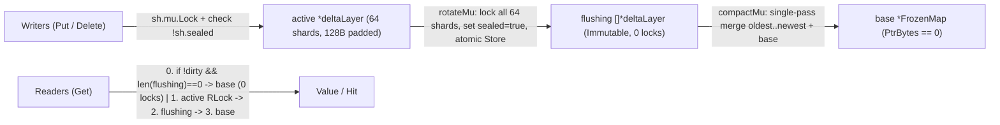

# `cnfgo` Architecture Specification

This document specifies the memory representation, code generation rules, concurrency protocols, binary snapshot format, and Go runtime invariants of `cnfgo` (targeting Go 1.26+ / 1.27+ with `CGO_ENABLED=0`).

---

## 1. Design Principles & Safety Boundaries

1. **Zero `PtrBytes` in Arena Tables:**
   In Go's garbage collector (including Go 1.27's page-oriented Green Tea GC in `runtime/mgcmark_greenteagc.go`), heap spans allocated for types with `abi.Type.PtrBytes == 0` are placed in `noscan` span classes. When the collector encounters a pointer to a `noscan` object, it marks the span bit and returns immediately without inspecting the object's payload (`if q.class.noscan() { return true }`).
   `cnfgo` transforms pointer-heavy object graphs into flat typed slices (`[]flatT`) where every field is an integer, float, fixed-size byte array, `NodeID uint32`, or `Span32{Off, Len uint32}`. Because `flatT` contains zero Go pointers, `[]flatT` has `PtrBytes == 0`.
2. **Zero `import "unsafe"` in Generated User Code:**
   Files emitted by `cmd/cnfgo` (`*_cnf.gen.go`) into user packages use exclusively safe, bounds-checked Go operations. This guarantees frictionless builds under strict `go vet`, `gopls`, and Bazel `rules_go` + `nogo` policies that restrict `unsafe` in application packages. Low-level zero-copy string sealing and `mmap` slice construction are strictly isolated inside `cnfrt` and `unsafemmap`.
3. **Never Hide Heap Pointers Inside Unscanned Memory:**
   `cnfgo` never stores Go heap addresses (`uintptr` or raw `*T` bytes) inside `noscan` buffers when referencing GC-managed objects. All internal graph edges are 32-bit `1`-based array indices (`NodeID`), and any Go runtime objects required at read time (such as pre-resolved `*time.Location` or zoned `netip.Addr` values) live in small, ordinary GC-scanned side tables on the `Snapshot` struct itself (`O(unique zones)`, typically `< 64` elements).

---

## 2. Arena Data Model (`Snapshot[T]`)

### 2.1 Typed Node Tables, Value-Struct Inlining & `NodeID`

For each reachable struct type `T` in a compilation unit, `cnfgo` generates a flat struct `flatT` containing only pointer-free primitives:

* **Non-Recursive Value-Struct Inlining:** If a non-root struct `S` is used exclusively by value across the entire schema (never referenced via `*S`, never an implementation of a closed interface, outside any recursion cycle / strongly connected component of size `> 1`, and its flat byte size does not exceed `128` bytes), `cmd/cnfgo` does **not** allocate a separate `nodesS` table or `uint32` `NodeID` indirection. Instead, `flatS` is embedded directly by value inside parent flat structs (`flatParent`) and stored directly in typed slice/array pools (`[]flatS`) and map value records (`flatKV`). Its generated view holds `{cnfSnap *Snapshot, cnfVal flatS}` directly with zero table lookup indirection while preserving `IsValid()`, `Snapshot()`, `Unfreeze()`, and all field getters. Non-recursive value structs larger than `128` bytes remain table nodes so `View` handles stay compact.
* **`NodeID uint32`:** For pointer-referenced, root, interface-implementing, or recursive structs, `1`-based index into `snap.nodesT []flatT`. `NodeID == 0` canonically represents `nil`. Actual slice lookup accesses `snap.nodesT[id-1]`.
* **`Span32`:** `struct { Off uint32; Len uint32 }` (8 bytes).
  * For `string` and `[]byte`: byte offset and byte length into `snap.strBlob string`.
  * For `[]Elem`: element offset and element count into the corresponding typed pool (`snap.pool<k>`).
  * **`nil` vs Empty Slice Sentinel:**
    * `nil` slice (`[]Elem(nil)`): `Span32{Off: math.MaxUint32, Len: 0}`.
    * Non-nil empty slice (`[]Elem{}`): `Span32{Off: 0, Len: 0}`.
* **Optional Scalar Pointers (`*int64`, `*bool`, `*float64`, `*string`, `*time.Time`, `*netip.Addr`, etc.):**
  Encoded inline inside `flatT` alongside a compact **presence bitmap** (`PresentBits uint8` / `uint16` / `uint32` / `uint64` / `[W]uint64`, scaled to the count of optional inline pointer fields). This preserves the exact distinction between `nil` and a pointer to the zero value (`&0`, `""`, `&false`) without allocating separate node tables.
* **Explicit Cross-Platform Alignment & Padding:**
  `cmd/cnfgo` orders fields by decreasing alignment and inserts explicit `_ [N]byte` padding fields so that `sizeof(flatT)` and every field offset are bit-for-bit identical across 64-bit (`amd64`, `arm64`, `riscv64`) and 32-bit (`386`, `arm`, `wasm`) architectures, where `int64`/`uint64`/`float64` otherwise have 4-byte natural alignment. Empty structs receive a 1-byte `_ [1]byte` placeholder. Zero-length arrays `[0]T` carry no payload and are omitted from flat structs, composite map keys, optional wrappers, and `flatKV` records; slices `[][0]T` allocate a `[1]byte` pool element so lengths and `nil`-vs-empty distinctions roundtrip with consistent non-zero element stride across architectures. The generated `init()` function asserts `reflect.TypeFor[flatT]().Size()` against the planned size (no `unsafe` is needed), and the generator's test suite checks every layout with `types.SizesFor` for `386`, `arm`, `arm64`, `wasm`, `mips`, `s390x` and `riscv64`.

### 2.2 Struct-Level Maps & Interfaces

* **`map[K]V` inside structs:**
  * Supported key types: `string`, `bool`, integers, floats (`NaN` rejected with `cnfrt.ErrNaNKey`, `-0.0` canonicalized to `+0.0`), `netip.Addr`, `netip.Prefix`, `netip.AddrPort`, fixed arrays `[N]scalar` of non-complex scalars, and flat comparable structs recursively composed of those types (stored inline in `flatKV` with zero pointer indirection).
  * By default (for example Kubernetes `Labels` and `Annotations`), encoded as a key-sorted run of `flatKV` pairs in a pool, searched by $O(\log n)$ binary search with zero per-map metadata overhead.
  * When annotated with `` `cnf:",hash"` ``, encoded as a `HashSpan` pairing the sorted `flatKV` run with an open-addressed power-of-two `uint32` index pool (`>= 2n` slots) for $O(1)$ lookups.
* **Closed Sum-Type Interfaces:**
  Interfaces annotated with `//cnf:implementations=TypeA,*TypeB` are encoded as `VariantTag{Tag uint16, Pad uint16, ID uint32}` (8 bytes); the generated interface view has `As<Type>()` accessors. Open interfaces such as `any` without registered implementations, channels, functions and unsafe pointers are rejected at code-generation time with a diagnostic pointing to `-codec` or `//cnf:implementations`.

### 2.3 Generated `View` Types & Zero-Allocation Iteration

For each `T`, `cnfgo` generates a lightweight value-type handle:

```go
type RouteNodeView struct {
    cnfSnap *RouteTableSnapshot // 8B pointer to snapshot root
    cnfID   uint32              // 4B 1-based NodeID (0 == invalid/nil)
}
```

Generated code names all of its unexported fields and helper methods with a `cnf` prefix followed by an upper-case letter (`cnfSnap`, `cnfID`, `cnfVal`, `cnfSpan`, `cnfRaw`, `cnfStr`, ...), so unexported user fields such as `id`, `raw`, `str` or `time` never collide with them. Field names of that form (`cnf` or `cnfX`) are rejected at analysis time, as are `Compact<T>` root fields whose getters would collide with a method of `Compact<T>` (`Raw`, `View`, `Detach`, `IsZero`, ...); `cmd/cnfgo` exits non-zero and writes nothing on any schema error.

* **Table vs Inline Views & Embedded Fields:** a view of a table node (`RouteNodeView`) is a 16-byte `{cnfSnap, cnfID}` handle; two such views are `==` exactly when they refer to the same node, and `NodeID()` exposes the index. A view of an inlined value struct (`MetaView`) carries a copy of the flat value (`{cnfSnap, cnfVal}`) instead: it has no `NodeID()`, its size is bounded by the `128`-byte inlining threshold, and Go's `==` compares `{cnfSnap, cnfVal}` directly (so equal values within the same snapshot compare equal, views from two distinct `*Snapshot` instances compare unequal, and an inline struct containing an IEEE-754 `NaN` float compares unequal to itself). Both kinds share `IsValid()`, `Snapshot()`, `Unfreeze()` and the field getters. Embedded struct fields are accessed through the embedded field's explicit method (for example `v.Meta().ID()`) rather than promoting inner getters onto the outer view, avoiding method-shadowing ambiguities.

* **Canonical Nil / Zero Value:** Whenever a child reference has `id == 0`, getters return the literal zero struct `RouteNodeView{}` (`cnfSnap: nil, cnfID: 0`), never `RouteNodeView{cnfSnap: s, cnfID: 0}`. Thus `v == (RouteNodeView{})` and `!v.IsValid()` are always equivalent. Like methods on a nil pointer, all field getters on a zero table view panic; on a zero inline view (`cnfSnap == nil, cnfVal == zero`), scalar, nested inline sub-view, slice-view, and map-view getters return zero/empty values, whereas string, byte, custom `-codec`, and table `NodeID` dereference getters panic. Callers should always test `IsValid()` first, just as they would test a `*T` for `nil`.
* **Built-in Methods:** Every table view has `IsValid()`, `NodeID()`, `Snapshot()` and `Unfreeze()` (a deep copy back into ordinary Go values). The generator reports a diagnostic when a field name collides with one of them. Multi-root schemas (`-type=A,B`) emit `Freeze<T>`, `FreezeTree<T>`, `FreezeCyclic<T>`, `Map<T>File`, `Write<T>SnapshotAtomic`, `Root<T>`, `Unfreeze<T>`, and `WithRoot<T>FaultSafe` for every root type.
* **Concrete `<Elem>SliceView` (`0 allocs/op` `iter.Seq`):**
  Slice getters return concrete generated value structs (e.g., `RouteRuleSliceView{cnfSnap *RouteTableSnapshot, cnfSpan cnfrt.Span32}`) with **zero `func` closure fields**. `All()` slices the underlying pool once before the loop (eliminating per-element bounds checks) and inlines completely under Go 1.26+/1.27+ range-over-func with `0` heap allocations alongside `Len()`, inlineable `At(i int)`, `EqualsAt` (for string slices), and `CopyTo(dst []T) []T` (for scalar slices).
* **String Lifetime, Inlining & `mmap` Safety:**
  * On heap snapshots (`!snap.isMmap`), `v.Name()` slices `snap.strBlob[off : off+len]` directly (`0` allocations).
  * Dictionary spans (`cnfrt.DictSpanBit`) resolve without a function call: a snapshot captures the string chunks of its `cnfrt.Dict` when it is built or loaded, and `s.rawStr()` slices `dictStrs[off>>21][off&(1<<21-1):][:len]`. The `nil` span sentinel takes the dictionary branch with `Len == 0` and returns `""`, so byte getters need no separate `nil` check.
  * On memory-mapped snapshots (`snap.isMmap`), `snap.cloneStrs` is unconditionally `true`: `s.str()` copies the bytes with `string([]byte(r))`, which the compiler lowers to a single allocation and copy, ensuring closing/unmapping the file can never leave dangling `string` headers in caller goroutines.
  * `s.rawStr()`, `s.str()` and every generated `<Field>()`, `<Field>Equals`, `Append<Field>`, `With<Field>`, `At` and `EqualsAt` accessor on strings and byte slices fit the Go compiler's inline budget (cost `<= 80`); the generator's `TestInlining` compiles the test schema with `-gcflags=-m=2` and fails if any of them stops inlining, and `cnfrt.Dict.MustGet` stays `//go:noinline` so its panic path is not duplicated into callers.
  * Every read, iteration, borrow, unfreeze, and export method keeps the snapshot pointer alive with `runtime.KeepAlive` across mapped-memory reads so `runtime.AddCleanup` cannot unmap a file while a caller is inside a getter or `With<Field>` callback.
  * For zero-allocation hot paths on both heap and `mmap` snapshots, `cnfgo` generates `<Field>Equals(s string) bool`, `Append<Field>(dst []byte) []byte`, `<Field>Len() int`, `<BytesField>IsNil() bool`, and `With<Field>(fn func(string))` (scoped borrow).

---

## 3. Built-in & Extensible Type Codecs (`-codec`)

Real-world structs frequently embed standard-library or third-party value types containing unexported pointers. `cnfgo` includes built-in codecs for `time.Time`, `net/netip`, and `k8s.io/apimachinery/pkg/api/resource.Quantity`, and supports user-supplied codecs via the repeatable flag `-codec import/path.Type=import/path.Adapter`. Versioned import paths such as `.../codec/v2` resolve their actual Go package name via `go list` and emit explicit import aliases when needed. A generic adapter is written with type arguments in which `T` stands for the target type, for example `-codec example.com/m.Quantity=github.com/Voskan/cnfgo/cnfrt/codecs/k8s.Quantity[T,*T]`. An adapter is any type implementing `cnfrt.Codec[T]` (`Size`, `Append`, `Decode`); encoders that may fail can additionally implement `cnfrt.FallibleCodec[T]` (`AppendErr`) so `FrozenBuilder`, `SlabMap`, and `TieredMap` return errors rather than panicking. Getters of codec fields return `(T, error)`, and the adapter's identity is part of the schema hash.

### 3.1 `time.Time` (16 Bytes, Lossless FixedZone & IANA Roundtrip)

`time.Time` contains `loc *time.Location`. Standard `MarshalBinary` or naive `loc.String()` serialization fails on anonymous fixed offsets: for example, `time.Parse(time.RFC3339, "2026-11-22T20:00:00+05:30")` produces a `*time.Location` whose `.String()` is `""`, which `time.LoadLocation("")` silently resets to `UTC`. Furthermore, `time.FixedZone("CET", 3600)` collides by name with the DST-aware IANA `"CET"` zone, and non-UTC zero instants (`time.Date(1, 1, 1, 3, 0, 0, 0, msk)`) satisfy `t.IsZero() == true` while having a non-UTC location.

`cnfgo` encodes `time.Time` in 16 pointer-free bytes (`FlatTime{UnixSec int64, Meta uint64}`):

* `UnixSec int64`: exact output of `t.Unix()` (for `time.Time{}`, `UnixSec == -62135596800`, `nsec == 0`, `locKind == LocUTC`; no special `IsZero()` shortcut is used, preserving non-UTC `IsZero()` locations). Monotonic clock readings are stripped (`t.Round(0)` semantics).
* `Meta uint64` bit layout:
  * Bits `0..29` (30 bits): `nsec` (`0..999,999,999`).
  * Bits `30..31` (2 bits): `locKind`:
    * `0` (`LocUTC`): `time.UTC` (fast path: `time.Unix(sec, nsec).UTC()`, `0` table lookups).
    * `1` (`LocFixed`): `FixedZone(name, offsetSec)`. Bits `32..51` (20 bits signed) store `offsetSec` in seconds (`-524288..+524287`); bits `52..63` (12 bits) store `nameIdx` (`0` = empty name `""`, `1..4095` = interned zone name in `snap.ext` or `Compact` tail). `LocTable.Encode` caches the precomputed `metaBits` per `*time.Location` pointer so repeated fixed-zone timestamps skip reflection entirely.
    * `2` (`LocIANA`): Named IANA zone (`"America/New_York"`). Bits `32..63` store `locIdx` into the snapshot's resolved `*time.Location` table (backed by `cnfrt.ResolveLocation` and `cnfrt.FixedLocation`, bounded lock-free copy-on-write process caches that clone zone names on cache miss so substrings from `Compact` or `mmap` buffers are never retained). Locations built via `time.LoadLocationFromTZData` whose name is absent from the system tzdb fall back to `LocFixed` using `t.Zone()`; offsets outside `int32` range fail with `ErrCapacityExceeded`. By default, `time.Local` is frozen deterministically as `LocFixed` using `t.Zone()` at freeze time unless `WithPreserveLocal()` is requested.
    * `3` (`LocIndexed`): Overflow fallback when a snapshot contains more than 4,095 distinct fixed zones or fixed offsets outside the 20-bit signed inline range.

`cnfrt.DefaultCodec[time.Time]()` uses a lossless self-delimited `time.Time` codec preserving UTC, IANA location names, and fixed zones in `FrozenMap`, `SlabMap`, and `TieredMap`.

### 3.2 `netip.Addr`, `netip.Prefix`, and `netip.AddrPort`

* **`netip.Addr` (20 bytes: `IP [16]byte`, `ZonedIdx uint16`, `Kind uint8`, `Pad uint8`):**
  Go's `netip.Addr` stores an internal `unique.Handle[addrDetail]` heap pointer. Calling `addr.WithZone(z)` on every getter read incurs `unique.Make` weak-pointer synchronization overhead during active GC mark phases.
  Instead:
  * Unzoned IPv4 (`netip.AddrFrom4`) and unzoned IPv6 (`netip.AddrFrom16`) have `ZonedIdx == 0` and reconstruct on the stack with zero heap pointers.
  * Zoned IPv6 addresses (`fe80::1%eth0`) deduplicate the full zoned `netip.Addr` during `Freeze` into `snap.zoned []netip.Addr` (`1`-based `ZonedIdx`). Getter reads return `snap.zoned[ZonedIdx-1]` with zero `WithZone` calls on the read path. (In standalone `Compact<T>`, rare zone names are stored in the `raw` ext table.)
* **`netip.Prefix` (20 bytes: `IP [16]byte`, `BitsPlusOne uint8`, `Kind uint8`, `Pad [2]byte`):**
  `netip.Prefix` strips IPv6 zones by specification, so no `ZonedIdx` is needed. `BitsPlusOne == 0` encodes `bits == -1` (invalid `netip.Prefix{}`), `1..129` encodes `0..128`, and raw IP bytes are preserved verbatim even when invalid.
* **`netip.AddrPort` (22 bytes padded to 24 bytes):** `FlatAddr` (20B) + `Port uint16` + `Pad [2]byte`.

All three `net/netip` types are also supported natively as both keys and values in `FrozenMap`, `SlabMap`, `TieredMap`, and struct-level `map[K]V` fields.

### 3.3 Custom Codecs & `resource.Quantity`

`-codec Type=Adapter` maps any external struct with unexported pointers into a `noscan` wire representation: the encoded bytes are stored as a `Span32` into `strBlob`. `cnfrt/codecs/k8s` provides a lossless codec for `k8s.io/apimachinery/pkg/api/resource.Quantity` (and any type with the same `String`/`UnmarshalJSON` method set) without importing Kubernetes modules: a quantity is stored as its canonical string form (`"250m"`, `"512Mi"`), which `resource.Quantity` parses back exactly, including arbitrary-precision values. The generator applies it automatically to fields of type `resource.Quantity`.

---

## 4. `Freeze` Engine & Bounded Temporary Memory

Naive graph freezing using `map[*T]uint32` and `map[string]Span32` creates hundreds of megabytes of GC-scanned temporary hash tables and triggers repeated `growslice` doublings. `cnfgo` bounds temporary memory overhead during `Freeze`; every temporary structure is pointer-free, and a freeze performs a few dozen allocations regardless of the graph size (see the measured costs in the README):

1. **Two-Pass Exact Pre-Sizing (`0` `growslice` Waste):**
   * **Pass 1 (Measure & Discover):** Traverses the input graph once, counting exact lengths for every node table and primitive slice pool, and the string byte volume after deduplication by the interning cache (see item 3). Maps are visited in sorted key order in both passes so the two passes see strings in the same order; maps with `>= 256` entries cache their sorted key slice from Pass 1 and reuse it in Pass 2 without re-sorting. Rejects inputs exceeding `uint32` limits (`math.MaxUint32 - 1` nodes or `math.MaxInt32 - 64` string blob bytes for 32-bit compatibility) with `cnfrt.ErrCapacityExceeded`.
   * **Pass 2 (Populate & Seal):** Allocates exact-capacity backing arrays (`make([]flatT, exactCount)` and `make([]byte, 0, strBytes)`), populates them linearly, and seals `strBuf` into an immutable `string` inside `cnfrt` via `unsafe.String` with zero copy. The visited table, cached key slices, and interning cache are released before the blob is sealed. Only when the blob is left with more than 1/8 of unused capacity (with `WithExactStringDedup()`, whose first pass counts every string) is it copied to its exact size.
   * **Hash Seed Randomization:** By default, each freeze selects a fresh 64-bit random seed via `cnfrt.RandomSeed()` (seeded from `crypto/rand`) to prevent adversarial hash-flooding against `cnf:",hash"` maps. Pass `cnfrt.WithDeterministicSeed()` (or `cnfrt.WithHashSeed(seed)`) when byte-for-byte reproducible images are required.
2. **Topology-Aware Cycle & DAG Handling:**
   * **`FreezeTree` (or `-tree`):** Performs zero visited-pointer tracking (`0 B` auxiliary map) and does not call `cnfrt.Escape(src)` (so stack-allocated roots remain on the stack), enforcing `depth <= maxDepth` (default `cnfrt.DefaultTreeMaxDepth = 4096`, returning `cnfrt.ErrCycleDetected` if exceeded).
   * **`Freeze` (DAG default):** Uses a flat, open-addressed `noscan` hash table `[]visitedEntry` (`struct { addr uintptr; tbl, val uint32 }`, `PtrBytes == 0`; pre-sizeable with `cnfrt.WithNodeHint(n)`) while keeping `runtime.KeepAlive(root)` live until `Freeze` completes so that addresses cannot be reused mid-pass (Go's collector does not move heap objects). IDs are assigned in reverse post-order, so every edge satisfies `childID > selfID`; directed cycles are rejected with `cnfrt.ErrCycleDetected` unless `FreezeCyclic` is invoked. Graph traversal is recursive, so its depth is bounded by `cnfrt.DefaultGraphMaxDepth` (`1 << 15`); `cnfrt.WithMaxDepth(n)` raises the limit up to the hard cap `cnfrt.MaxGraphDepth` (`1 << 16`), and deeper inputs (for example a 40,000-node linked list under the default) fail with `cnfrt.ErrCapacityExceeded` instead of exhausting the goroutine stack.
   * **`FreezeCyclic`:** Allocates node IDs in pre-order before populating edges and sets `FlagCyclicAllowed` in the snapshot header.
3. **Bounded `16 MiB` `noscan` String Interning Cache:**
   Instead of `map[string]Span32`, default string deduplication uses a two-way set-associative cache of `internSlot` (`struct { hash uint64; off, len uint32 }`, 16 bytes, `PtrBytes == 0`), comparing candidate bytes directly against `strBuf[off:off+len]`. Storing the full 64-bit `wyhash` digest eliminates birthday-paradox false collisions between Pass 1 and Pass 2 on million-string workloads. The cache starts with 32 slots embedded in the builder and doubles in place while more than half full below 64 slots, and more than 1/8 full above, up to $2^{20}$ slots (`16 MiB`). Callers who require 100% exhaustive deduplication over massive high-cardinality corpora may opt into `WithExactStringDedup()`, and large offline exports can stream directly to disk via `ChunkedWriter`.

---

## 5. `Compact<T>` and `SlabMap[K, V]`

### 5.1 `Compact<T>` (`16` Bytes, Slim Format `0x03`) & Shared `cnfrt.Dict`

```go
type CompactPod struct {
    cnfRaw string
}
```

The generator emits one concrete type per `-compact` root (`CompactPod` for `Pod`).

* **Zero Extra Pointers & Single-Copy Slim Layout (`0x03`):** a compact value contains **only** `cnfRaw string` (`16` bytes total; no side-table pointer fields). The root `flatT` is stored **once** at fixed byte offset 1 (never duplicated in a separate table section), and compile-time-known section layouts replace per-section directories with a compact presence bitmask and unsigned varint counts:
  ```text
  flags u8 (0x03 | Ext | Dict | Cyclic | Seed)
  | root flatT (stored once)
  | strBase u32
  | [dictToken u64]          (if SlimFlagDict)
  | [extOff u32, extLen u32] (if SlimFlagExt)
  | [hashSeed u64]           (if SlimFlagSeed)
  | schemaHash u64
  | sectionMask [(len(specs)+7)/8]byte
  | uvarint counts (present sections only)
  | aligned payloads ordered by descending ElemAlign (8 -> 4 -> 2 -> 1)
  | CRC32C u32
  ```
  * Because `specs` is ordered by descending element alignment (`8 -> 4 -> 2 -> 1`), at most one alignment pad is emitted before the first section with alignment `> 1` and zero inter-section padding is needed thereafter.
  * When the root type is self-recursive (`len(nodesRoot) > 1`), only `nodesRoot[1:]` is stored in the optional extra-root table section; for non-recursive roots `View()` decodes `raw[1:1+rootSize]` directly into a 1-element inline slot on the snapshot header (`0` extra slice allocations) and casts auxiliary sections in place via `unsafemmap.Cast` without recomputing CRC32C.
  * `ParseCompact<T>(raw, mode, opts ...cnfrt.ParseOption)` verifies untrusted bytes across all three `VerifyMode` tiers (trailing `CRC32C`, canonical varints, zero alignment padding, exact section end, `strBase`/`extOff` consistency, the dictionary token, and full `Snapshot.validate()` under `VerifyUntrusted`). `BorrowCompact<T>(raw string)`, `BorrowCompact<T>Bytes(raw []byte)`, `(*Compact<T>).DecodeCNF`, and `compact<T>Codec.Decode` validate the compact prefix (including the schema hash and dictionary liveness) via `cnfrt.CheckSlimCompactString` / `cnfrt.CheckSlimCompactBytes` — keeping all four entry points within Go's inline budget for zero-copy reads inside `SlabMap.Borrow` or `FrozenMap.Borrow`; the `Bytes` form aliases the slice without copying and must not outlive the callback.
  * `Pack<T>` freezes in the mode selected by `-tree` (graph by default); `PackTree<T>` and `PackCyclic<T>` select tree or cyclic mode explicitly, and `PackCyclic<T>` sets `SlimFlagCyclic` so that `ParseCompact<T>` accepts cycles.
  * `View()` decodes the image in place but allocates one snapshot header; the direct getters of `Compact<T>` never allocate. `View()` panics on a corrupt value or one whose dictionary was closed, while `TryView()` returns the error (`cnfrt.ErrUnknownDict` or a header error).
* **Shared Pointer-Free String Dictionary (`cnfrt.Dict`, `cnfrt.WithDict`):**
  * `cnfrt.NewDict(maxBytes)` creates a bounded, thread-safe, `noscan` string dictionary backed by append-only immutable byte chunks (up to 2 MiB each) and a pointer-free open-addressed hash table (`PtrBytes == 0`) hashed with a per-`Dict` random seed, defaulting to a `32 MiB` ceiling (`cnfrt.DefaultDictMaxBytes`; budgets below `cnfrt.MinDictMaxBytes = 4 KiB` are raised to it). Once full, the dictionary becomes completely lock-free read-only and never grows unboundedly.
  * **Memory Budget & Progressive Chunk Growth:** `maxBytes` bounds everything the dictionary allocates: string chunk bytes, `16` bytes per hash index slot, and `4` bytes per seen-twice filter entry (`DictStats.MemBytes` reports the total). The initial index and filter are scaled so that together they take at most 1/8 of the budget (the filter is capped at 1 MiB). The index doubles at load 1/2; when doubling would exceed the budget it fills up to load 3/4 and the dictionary then becomes full. String chunks grow progressively from `min(max(limit/16, 4 KiB), 64 KiB)` by doubling up to `chunkCap = min(max(limit/4, 4 KiB), 2 MiB)` and halving the remaining budget (`max(n, rem/2)`) near the tail, avoiding premature budget exhaustion on small caps (`<= 2 MiB`) while minimizing unused tail slack. The dictionary also becomes full when less than 64 bytes of budget remain, or after 8 consecutive rejected strings with at least 75% of the budget used, so a nearly full dictionary stops taking the write lock.
  * **Seen-Twice Admission Filter:** a `noscan` atomic hash filter (`[]atomic.Uint32`) prevents unique per-object strings (`UID`, `SKU`, `Pod.Name`) from consuming dictionary space: first observations stay in the local `Compact` string blob, and repeated strings are admitted on their second observation. Pass 1 (`MeasureString`) calls read-only `Dict.Lookup` so Pass 1 never trips the filter; Pass 2 (`String`) calls `Dict.Intern`. Byte slices (`[]byte`) always remain local.
  * **Dictionary Identity (`dictToken`):** dictionary spans set the high bit `cnfrt.DictSpanBit` (`1 << 31`, with `Len > 0`, never colliding with `NilSpan` which has `Len == 0`); the remaining 31 bits address chunk `off >> 21` at byte `off & (1<<21 - 1)`. `Compact<T>` remains 16 bytes by storing an 8-byte `dictToken` inside `cnfRaw` when `SlimFlagDict` is set. The low 16 bits of the token select a slot in a process-wide registry of `65,535` entries and the high 48 bits are a random non-zero nonce, so a value resolves strings only from the exact `Dict` instance that encoded it, even after `Close` returns the slot to the free list and another `Dict` reuses it. `Dict.Token()` returns the token and `cnfrt.LookupDictToken` resolves it lock-free. When all slots are in use, `NewDict` returns a dictionary with token `0` that never admits strings, so packing transparently keeps every string local.
  * **Untrusted Input:** a token is a process-local capability, not data to trust. `ParseCompact<T>(raw, cnfrt.VerifyUntrusted)` rejects a value carrying `SlimFlagDict` with `cnfrt.ErrDictRequired` unless the caller names the expected dictionary with `cnfrt.AllowDict(d)` and the token matches `d`; if `d` is closed it returns `cnfrt.ErrUnknownDict`. Span validation calls `d.ValidCapturedSpan(s.dictStrs, sp)` to verify each chunk index and byte range against both the snapshot's captured chunk slice and the chunk's committed atomic length, preventing TOCTOU out-of-bounds panics when concurrent writers append new chunks. Validation also charges dictionary strings to the work budget (`min(32 * DictStats().Bytes, 64 MiB)`). The trusted modes resolve the token through the registry.
  * **Persistence & Lifecycle Safety:** `Compact<T>.UsesDict()` and `Snapshot.UsesDict()` report dictionary usage. Calling `WriteTo` or `MarshalCNF` on a dict-backed snapshot, or on a `FrozenMap` whose values implement `cnfrt.DictUser` and use a dictionary, returns `cnfrt.ErrDictRequired`. `Compact<T>.Detach(opts ...cnfrt.FreezeOption)` materializes all dictionary strings locally into a standalone, serializable value; it always defaults to preserving the original value's hash seed and `time.Local` encoding (which caller options may override) and always enforces `WithDict(nil)` last, so detaching twice yields identical bytes and never re-attaches a dictionary.
  * **`Close` Contract:** `Dict.Close()` is idempotent; afterwards the dictionary admits nothing, `Pack<T>` and `Freeze<T>` with it (including a concurrent `Close()` occurring between Pass 1 and Pass 2) fail with `cnfrt.ErrUnknownDict`, and every checked entry point on values that reference it (`ParseCompact<T>`, `BorrowCompact<T>`, `TryView`, `Snapshot`, `Unpack`, `Detach`) returns `cnfrt.ErrUnknownDict` (`SlabMap.Get` and `FrozenMap.Get` fail decoding and return `(zero, false)`, and `All` skips undecodable entries), while `View()` and direct string getters panic. Do not close a `Dict` while containers holding `Compact` values that reference it remain live. Snapshots and views created before `Close` captured the chunks they reference and stay readable; the chunks are released once nothing references them.
* **Getter Efficiency (`0 allocs/op`):**
  Root getters of scalar, fixed scalar array, string, bytes, time, `netip` and optional fields read constant offsets through safe Go slicing (`cnfrt.U32S` and `binary.LittleEndian.Uint*` over constant-bounds substrings), with `<Field>Equals`, `<Field>Len`, and `<BytesField>IsNil` helpers for string and byte fields. UTC timestamps and unzoned `netip.Addr` values decode directly without reading the `ext` table. The generator's `TestCompactBoundsChecks` compiles the schema with `-d=ssa/check_bce/debug=1` and verifies that fixed-offset scalar and string root getters perform at most one bounds check and time/address/ext getters perform at most two; `TestInlining` verifies that scalar root getters inline into callers. Every Compact type also implements `cnfrt.SchemaHasher` (`SchemaHashCNF()`), which `CheckSlimCompactPrefix` compares against the header. `Pack<T>` enforces `len(raw) <= math.MaxInt32 - 64`, so offsets never overflow `int` on 32-bit platforms.
* **Concrete Codec:** every Compact type implements `cnfrt.CodecProvider`; its `CodecCNF()` returns a concrete `cnfrt.Codec`, which `cnfrt.DefaultCodec` prefers, so `FrozenMap`, `SlabMap` and `TieredMap` encode and decode Compact values without converting them to interfaces. The codec also implements `cnfrt.UntrustedValidator` (validation runs `ParseCompact<T>(src, VerifyUntrusted)`) and `cnfrt.AlignedCodec` (`AlignCNF() == 8`), so both `FrozenBuilder` and `SlabMap` pad values to 8-byte alignment and `View()` casts embedded tables in place.
* **Pack Cost & Footprint:** `Pack<T>` reuses a pooled freezer (embedding `cnfrt.Builder` with 32 inline intern slots that reset lazily and bypass interning when a value has at most one local string) whose scratch snapshot tables and string buffer are kept between calls (up to 64 KiB each, larger buffers are dropped), and stack-allocated `Section` buffers, precomputing the exact slim compact wire length so that the returned value is the only allocation. A standalone 296-byte `CompactItem` packs in ~446 ns / 1 allocation (`444 ns` / 1 allocation with `WithDict`); `TestPackCost` fails above 2 allocations. Combined with value-struct inlining and `Dict`, `Compact` cuts total heap usage by **2.3–2.5×** relative to native Go graphs (100,000 Kubernetes pods drop from `158.0 MiB` to `92.7 MiB` standalone and `63.5 MiB` with `Dict`; 1,000,000 catalog items drop from `616.0 MiB` to `358.6 MiB` standalone and `269.4 MiB` with `Dict`).

### 5.2 `SlabMap[K, V]` (`0` Scanned Map Pointers)

When an application stores hundreds of thousands or millions of compact objects and requires **literal `0` GC pointer scanning** alongside fast point `Put`/`Get`/`Delete`:

* `SlabMap[K, V]` (`cnfrt`) indexes entries via `map[uint64]slabSlot` where `slabSlot` is `{slab uint32, off uint32}` (`PtrBytes == 0` for both key and value, so Go allocates all SwissTable groups in `noscan` spans).
* The map is split into **64 shards** selected by the top six bits of the key hash. Each `slabShard` is padded to **256 bytes** (a multiple of 128-byte ARM64/Apple Silicon cache lines) so neighboring shard locks never share a cache line. Each shard owns a reusable `scratch` buffer under its lock so small `Put` calls make `0 allocs/op` and report `FallibleCodec` errors cleanly without mutating slabs.
* Records consist of a 16-byte header (next record in the hash chain, key and value lengths) followed by the encoded key, alignment padding up to `AlignedCodec.AlignCNF()` (`8` bytes for `Compact<T>`), and the value bytes, stored inside `[]byte` slabs. A shard's first slab is 4 KiB and each new slab doubles (with 32-bit overflow protection) up to `DefaultSlabSize` (256 KiB). A record larger than the slab size gets a slab of its own.
* Hash collisions on the 64-bit seeded `wyhash` key hash are handled soundly by chaining records and comparing the exact encoded key bytes on every `Get`/`Put`/`Delete`. `string`, 64-bit integer (`keyFixed8`), and 32-bit integer (`keyFixed4`) keys use specialized zero-allocation fast paths (`HashUint64`/`HashUint32` and direct 8/4-byte little-endian key comparisons) across `Put`, `Get`, `Delete`, and `Borrow`.
* Deleted/overwritten space is tracked per slab: sealed 100%-dead slabs are released immediately, 100%-dead active slabs rewind in place, and sealed slabs whose dead bytes exceed half of their written bytes (`dead > used/2`) are compacted asynchronously. `Compact()` waits for any in-flight background compaction to finish and reclaims all qualifying slabs. `Get` decodes the value under the shard's read lock with `CloneStrings` semantics; `Borrow` gives zero-copy access to the encoded value under the read lock via specialized single-defer shard helpers (combining with `BorrowCompact<T>Bytes` for zero-copy `Compact` reads); `All()` snapshots one shard at a time and releases the lock before yielding, so callers may safely mutate the map during iteration.

---

## 6. `FrozenMap[K, V]`

`FrozenMap[K, V]` is an immutable, flat open-addressed hash table (`PtrBytes == 0`) embeddable in RAM snapshots and `.cnf` files:

* **Cross-Process `wyhash` & Randomized Default Seeds:** Go's `hash/maphash` uses unserializable per-process seeds and cannot persist to `.cnf` files. `cnfrt` implements a concrete, BCE-clean pure-Go **`wyhash` (v4)** parameterized by an explicit `seed uint64` stored in the image header, so a persisted table is probed identically by any process on any platform. By default `MapOptions.Seed == 0` selects `RandomSeed()`, and `FrozenBuilder.Finish` abandons a table as soon as its cumulative probe count exceeds the linear budget `8*n + 64` and rebuilds it under a new seed (up to 4 times), so a bad seed costs `O(n)` before reseeding. Set `MapOptions.DeterministicSeed = true` for `DefaultSeed`, or `MapOptions.Seed` for an explicit seed; a fixed seed disables reseeding, so it is meant for trusted keys: keys crafted to collide under a known seed degrade the build to quadratic probing, and `Validate` rejects the resulting table.
* **Zero-Allocation Fast Paths:** `FrozenMap.find` dispatches directly to `lookup` (for `string` keys), `lookupUint64` (inlineable `HashUint64` + register 8-byte comparison for 64-bit integers), and `lookupUint32` (inlineable `HashUint32` + register 4-byte comparison for 32-bit integers), verifying matched SWAR control bytes directly in registers without redundant memory loads, and `DefaultCodec` provides specialized codecs for strings, booleans, and fixed-width numbers, giving `0 allocs/op` on lookups.
* **IEEE-754 Float, `net/netip` & Composite Key Invariants:**
  * `NaN` keys (`k != k`, standalone `float32`/`float64` or inside composite struct/array keys): rejected at `Add` / `Put` with `cnfrt.ErrNaNKey`; `Get(k)` returns `(zero, false)` in $O(1)$.
  * Signed zero (`-0.0` vs `+0.0`): canonicalized (`if f == 0 { bits = 0 }`) during key hashing and key equality, matching Go's built-in `map` semantics. Float values preserve exact bits.
  * `netip.Addr`, `netip.Prefix`, and `netip.AddrPort` use canonical self-delimited encodings preserving IPv6 zones and invalid prefixes.
  * Composite struct keys: compiler padding bytes are skipped by the layout encoder before hashing.
* **Value Lifetime (`MapOptions.CloneStrings` & `Borrow`):** by default decoded strings, byte slices and self-encoded values alias the map's data blob, which is immutable. With `CloneStrings` every decoded value is a copy. `unsafemmap.OpenFrozenMap` always sets it and attaches a `runtime.AddCleanup` that releases the mapping once the map is unreachable; every read/iteration method (`Get`, `GetEncoded`, `Has`, `Borrow`, `All`, `RawEntries`) calls `runtime.KeepAlive(m)`. `Borrow(k, fn)` exposes the raw encoded value directly without copying even when `CloneStrings` is set.
* **Strict $O(N)$ Untrusted Validation:** `unsafemmap.FrozenMapFromImage` with `VerifyUntrusted` builds the map over a private aligned copy of the input. `Validate` verifies every slot in strict linear time: 64-bit overflow-safe span bounds, cumulative key+value span bytes `<= len(data)` (rejecting overlapping span bombs), canonical key re-encoding, `cnfrt.ValidateEncoded` on values, matching control bytes, load factor `<= 7/8`, occupied count equal to `Len`, and every key reachable at its own slot within a linear probe budget (`totalProbes <= 8*n + 64`). Key comparisons are charged by key length against a second budget of `32*len(data) + 65536` bytes, so many long keys sharing a control byte cannot make validation superlinear. In unvalidated modes, `All()` and `RawEntries()` also check control bytes (`<= 0x7f`) and 64-bit span bounds before slicing, skipping corrupt slots instead of panicking.
* **Schema Hash:** standalone images carry `FrozenMapSchema[K, V]()`, a hash of a structural signature of both types. Value types implementing `cnfrt.SchemaHasher` (every generated `Compact<T>`) contribute their `SchemaHashCNF()`, so a map of Compact values is rejected after the Compact schema changes even if the Go type signature does not.
* **Fault Safety:** `FrozenMap.WithFaultSafe(fn)` runs `fn` with `debug.SetPanicOnFault` enabled and converts a memory fault (for example a truncated memory-mapped file) into `cnfrt.ErrMmapFault`; `cnfrt.FaultSafe` does the same for arbitrary code.
* **Bounded Probing Against Corrupted Archives:** every probe loop terminates after at most `numGroups + 1` groups even if a corrupted unvalidated table contains no `ctrlEmpty` bytes.

---

## 7. `TieredMap[K, V]` — Race-Free 3-Phase Concurrent Cache

`TieredMap[K, V]` serves high-throughput reads over a `noscan` `FrozenMap` base while absorbing concurrent point mutations (`Put`/`Delete`) with **zero lost writes** and **zero zombie-key resurrections**.



### 7.1 State & Epoch Structure

```go
type entryState uint8
const (
    stateMissing   entryState = 0
    stateValue     entryState = 1
    stateTombstone entryState = 2
)

type epoch[K comparable, V any] struct {
    active   *deltaLayer[K, V]   // mutable sharded map (64 shards, each padded to 128 bytes)
    flushing []*deltaLayer[K, V] // immutable sealed layers, ordered newest -> oldest (len <= maxFlushing)
    base     *cnfrt.FrozenMap[K, V]
}
```

### 7.2 Concurrency & Memory-Model Proof

1. **Writer Protocol (`Put` / `TryPut` / `Delete`):**
   `TryPut` rejects keys containing `NaN` (`cnfrt.ErrNaNKey`) and synchronously validates values whose codec implements `cnfrt.FallibleCodec` before mutating any shard. Each write locks its shard (`hash & 63`), retries on the latest epoch if `sh.sealed`, sets `l.dirty` before releasing the shard lock, writes the entry, updates the approximate delta counter `l.delta`, and triggers rotation when `l.n` reaches the flush threshold.
2. **Lock-Free Clean Fast Path in `Get`:**
   `Get(k)` loads `ep := c.epoch.Load()` and checks `activeDirty := ep.active.dirty.Load()`. When `!activeDirty && len(ep.flushing) == 0`, it skips key hashing and shard locking entirely and probes `ep.base.Get(k)` directly (`0 allocs/op`). Because writers set `l.dirty` before releasing `sh.mu`, no reader can observe a write while `dirty` is false, and any `Get` starting after `Put` returns observes `dirty == true` (or a newer epoch containing the write).
3. **Seal-Before-Publish Rotation (`rotateMu`):**
   When `active` reaches `max(MinFlushEntries, base.Len()/FlushRatioDivisor)`, rotation acquires `rotateMu`, locks all 64 shards (`0..63`) in ascending order, marks `sh.sealed = true`, publishes the new epoch via `c.epoch.Store` while holding all 64 locks, and unlocks `0..63`. Sealed layers are immutable and read without locks.
4. **Non-Rotating `Snapshot()`, `Len()`, `Range()` & `ApproxLen()`:**
   `Snapshot()` (and therefore `Len()` and `Range()`) never rotates `ep.active` and never triggers background compaction, strictly preserving `MaxFlushing`. If `ep.active.dirty` is false it returns `ep.flushing` + `ep.base` directly; otherwise it acquires all 64 shard `RLock`s in ascending order (retrying on a fresh epoch if any shard was sealed concurrently), clones only non-empty shards into a detached immutable layer, and unlocks. `ApproxLen()` returns an approximate count in lock-free $O(1)$ time with `0 allocs/op` by summing `ep.base.Len()` and layer delta counters.
5. **Compaction, Error Recovery & Backpressure:**
   Under `compactMu`, `merge` preallocates `FrozenBuilder`'s data buffer via `GrowData` and merges `snap.base` + `snap.flushing` in a single pass, dropping tombstones only against `base`. Because the base is rebuilt, every compaction — including an explicit `Flush()` — costs `O(|base| + |delta|)` time and memory however few keys changed; the rotation threshold `max(MinFlushEntries, base.Len()/FlushRatioDivisor)` amortizes this to `O(FlushRatioDivisor)` per write, so frequent explicit `Flush` calls on a large map should be avoided. `Close()` stops the background compactor; the map remains usable and later rotations compact synchronously. Upon publishing the new base under `rotateMu`, `c.err` is cleared to `nil` and throttled writers are woken. If a merge fails, `c.err` records the error (inspectable via `LastError()` and `Flush()`), throttled writers are woken so they never deadlock, and the layers remain intact so reads stay correct.

---

## 8. `.cnf` Binary Format & `unsafemmap`

### 8.1 Binary Layout (`64`-Byte Aligned Zero-Relocation Sections)

```text
+-------------------------------------------------------------------+ 0x00
| 64-Byte Header:                                                   |
|   [0..4]   Magic = "CNFG" (0x47464E43 LE)                         |
|   [4..6]   FormatVersion = 0x0002 (uint16 LE)                     |
|   [6]      Endianness = 0x01 (Little-Endian)                      |
|   [7]      ArchIndexWidth = 0x04 (32-bit indices)                 |
|   [8..12]  Flags (Bit0: CyclicAllowed, Bit1: FullStringIntern)    |
|   [12..16] SectionCount (uint32 LE)                               |
|   [16..24] SchemaHash (uint64 LE, canonical layout + codec digest)|
|   [24..32] HashSeed (uint64 LE, wyhash seed for hash tables)      |
|   [32..40] RootInfo (RootTableID uint32 + RootNodeID uint32)      |
|   [40..48] TotalFileSize (uint64 LE)                              |
|   [48..56] Reserved (zeroed)                                      |
|   [56..60] DirCRC32C (Castagnoli CRC32 of Section Directory)      |
|   [60..64] HeaderCRC32C (Castagnoli CRC32 of bytes [0..60])       |
+-------------------------------------------------------------------+ 0x40
| Section Directory (N * 32-byte entries, padded to 64B boundary):  |
|   SectionKind uint16 | ElemAlign uint16 | TypeTag uint32          |
|   ByteOffset uint64 (must be 64B aligned)                         |
|   ByteLen    uint64                                               |
|   ElemCount  uint32 | SectionCRC32C uint32                        |
+-------------------------------------------------------------------+ 64B aligned
| Section Payloads (each padded with 0x00 to 64-byte alignment):    |
|   - Typed flatT Node Slices                                       |
|   - Primitive & Span32 Slice Pools                                |
|   - FrozenMap Control + Slot Arrays                               |
|   - Contiguous strBlob                                            |
|   - Ext Metadata Table (IANA names, FixedZone names, zoned IPv6)  |
+-------------------------------------------------------------------+ EOF
```

* **Canonical `SchemaHash`:** Computed over exact field names, primitive types, byte offsets, `sizeof(flatT)`, and the identity of every `-codec` adapter — independent of the package's import path, directory, declaration formatting, or `-prefix` flag: types of the package being generated are hashed by their canonical unprefixed local names, so moving a package, adding a `/v2` module suffix, or changing `-prefix` keeps existing files and `Compact<T>` values readable, while types and adapters from other packages keep their full import paths.
* **Unique Sections:** Both `.cnf` and compact directory parsers reject duplicate `(Kind, Tag)` pairs.
* **Endianness Portability:** `unsafemmap` zero-copy casting (`unsafe.Slice((*flatT)(ptr), count)`) is compiled on little-endian architectures (`amd64`, `arm64`, `riscv64`, `386`, `arm`, `wasm`, `ppc64le`, `loong64`, `mipsle`, `mips64le`). Big-endian targets (`s390x`, `ppc64`, `mips`, `mips64`) automatically compile a safe `binary.Decode` fallback; `-tags cnfgo_portable` exercises the same fallback on little-endian machines. Misaligned input buffers are copied rather than aliased.
* **Atomic Persistence (`WriteSnapshotAtomic` & `ChunkedWriter`):** `WriteSnapshotAtomic` writes to `<path>.tmp.<pid>.<rand>` (16 random hex digits) in the destination directory, calls `file.Sync()`, atomically renames over `<path>`, and `fsync`s the parent directory; the temporary file is removed on any error. `ChunkedWriter.Close()` retains any write/seek error so repeated `Close()` calls return the same error, and `Write` after `Close` returns `cnfrt.ErrClosed` without touching the output. Calling `WriteTo` or `MarshalCNF` on a closed memory-mapped snapshot returns `cnfrt.ErrClosed`.

### 8.2 `MAP_PRIVATE` Lifecycle & 3-Tier Verification

1. **`MAP_PRIVATE` + `PROT_READ`:**
   `unsafemmap` maps files using `syscall.MAP_PRIVATE` with `syscall.PROT_READ`. The OS kernel shares clean page-cache frames across local processes identically to `MAP_SHARED`, while isolating the process from accidental copy-on-write corruption.
2. **GC-Safe `munmap` Lifecycle:**
   `unsafemmap` attaches `runtime.AddCleanup(snap, cleanupMapping, handle)` (where `handle` holds only the `[]byte` mapping and an `atomic.Bool` closed flag — never a reference back to `snap`) alongside an idempotent `Close() error` method. All snapshot readers use `runtime.KeepAlive` to prevent premature cleanup while reading mapped bytes. `WithRoot<T>FaultSafe` wraps execution in goroutine-local `debug.SetPanicOnFault(true)` + `recover()` to convert external file-truncation `SIGBUS` faults into `cnfrt.ErrMmapFault`.
3. **Three Verification Modes (`cnfrt.VerifyMode`):**
   * **`VerifyTrustedHeader` (tens of µs, Instant Cold Start):** Validates file size, 64B Header + `HeaderCRC32C`, `SchemaHash`, section directory `DirCRC32C`, overflow-safe section bounds, 64-byte file offset alignment and runtime pointer alignment, and `FrozenMap` geometry, then returns immediately so OS pages fault lazily.
   * **`VerifyChecksum` (bounded by `CRC32C` throughput):** Performs `VerifyTrustedHeader` plus hardware-accelerated `CRC32C` verification over every section payload.
   * **`VerifyUntrusted` (strict $O(N)$ validation for untrusted inputs):** Copies bytes into aligned private heap memory, verifies all checksums, checks every `NodeID`, `Span32`, `VariantTag`, boolean byte, location index, and zone index, enforces linear work and probe budgets (`workBudget = 32*SizeBytes + 65536` for string and zoned `netip.Addr`/`netip.AddrPort` map keys, plus `32 * len(zone)` per zoned address and `min(32 * DictStats().Bytes, 64 MiB)` when a `Dict` is attached, and `totalProbes <= 8*n + 64` for `cnf:",hash"` maps), requires `cnfrt.AllowDict` for dictionary-backed Compact values, checks `childID > selfID` within tables, and runs a flat-buffer iterative DFS (`cnfrt.CheckAcyclic`) across mutually recursive strongly connected components when `FlagCyclicAllowed == 0`.

---

## 9. Substring & View Retention Diagnostics (`LeakDetector`)

In Go, taking a substring `name := view.Name()` on a heap `Snapshot` shares the underlying `snap.strBlob` backing array, and retaining a `NodeView` struct retains the entire `*Snapshot`. If `*Snapshot` itself becomes unreachable while a single `12`-byte substring stays in a global buffer or map, `*Snapshot` is collected while the `strBlob` backing array remains pinned.

`cnfrt.EnableLeakDetector(threshold time.Duration, onLeak func(LeakReport))` installs a process-wide detector; every snapshot created afterwards by generated code (`Freeze*`, `Map*File`, `Unmarshal*`) is registered with **two independent `weak.Pointer` / `runtime.AddCleanup` sentinels**:

1. **Snapshot Sentinel:** Tracks reachability of `*Snapshot` (detecting retained `View` structs after `snap.MarkRetired()`).
2. **String-Blob Sentinel:** When the snapshot owns its string blob — it was frozen, or loaded from a private heap copy (`VerifyUntrusted`) — and `len(snap.strBlob) >= 16` (avoiding Go's tiny-allocator block sharing for `< 16 B` allocations), tracks reachability of `unsafe.StringData(snap.strBlob)` independently — catching leaked substrings even after `*Snapshot` has been reclaimed by the GC.

A blob that aliases memory the snapshot does not own (a file mapping, or a caller's buffer passed to `Unmarshal<Snap>` with `VerifyTrustedHeader` or `VerifyChecksum`) is never watched. Background check timers stop rescheduling once all currently applicable reports for an entry have fired, and re-arm only if the snapshot is later collected while its blob remains pinned.
