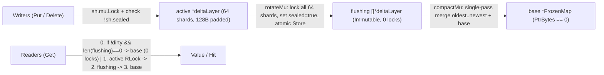

# cnfgo Architecture Specification

This document specifies the memory representation, code generation rules, concurrency protocols, binary snapshot format, and Go runtime invariants of `cnfgo` (targeting Go 1.26+ / 1.27+ with `CGO_ENABLED=0`).

## 1. Design Principles and Safety Boundaries

1. Zero `PtrBytes` in arena tables:
   In Go's garbage collector (including Go 1.27's page-oriented Green Tea GC in `runtime/mgcmark_greenteagc.go`), heap spans allocated for types with `abi.Type.PtrBytes == 0` are placed in `noscan` span classes. When the collector encounters a pointer to a `noscan` object, it marks the span bit and returns immediately without inspecting the object's payload (`if q.class.noscan() { return true }`).
   `cnfgo` transforms pointer-heavy object graphs into flat typed slices (`[]flatT`) where every field is an integer, float, fixed-size byte array, `NodeID uint32`, or `Span32{Off, Len uint32}`. Because `flatT` contains no Go pointers, `[]flatT` has `PtrBytes == 0`.
2. No `import "unsafe"` in generated user code:
   Files emitted by `cmd/cnfgo` (`*_cnf.gen.go`) into user packages use safe, bounds-checked Go operations only. This keeps builds clean under strict `go vet`, `gopls`, and Bazel `rules_go` + `nogo` policies that restrict `unsafe` in application packages. Zero-copy string sealing and `mmap` slice construction stay isolated inside `cnfrt` and `unsafemmap`.
3. No heap pointers hidden inside unscanned memory:
   `cnfgo` never stores Go heap addresses (`uintptr` or raw `*T` bytes) inside `noscan` buffers when referencing GC-managed objects. Internal graph edges are 32-bit 1-based array indices (`NodeID`), and any Go runtime objects required at read time (such as resolved `*time.Location` or zoned `netip.Addr` values) live in small, ordinary GC-scanned side slices on the `Snapshot` struct itself (`O(unique zones)`, typically under 64 elements).

## 2. Arena Data Model (`Snapshot[T]`)

### 2.1 Typed Node Tables, Value-Struct Inlining, and `NodeID`

For each reachable struct type `T` in a compilation unit, `cnfgo` generates a flat struct `flatT` containing only pointer-free primitives:

* Non-recursive value-struct inlining: if a non-root struct `S` is used exclusively by value across the schema (never referenced via `*S`, never an implementation of a closed interface, outside any recursion cycle or strongly connected component of size `> 1`, and its flat byte size does not exceed 128 bytes), `cmd/cnfgo` does not allocate a separate `nodesS` table or `uint32` `NodeID` indirection. Instead, `flatS` is embedded directly by value inside parent flat structs (`flatParent`) and stored directly in typed slice/array pools (`[]flatS`) and map value records (`flatKV`). Its generated view holds `{cnfSnap *Snapshot, cnfVal flatS}` directly without table indirection while preserving `IsValid()`, `Snapshot()`, `Unfreeze()`, and all field getters. Non-recursive value structs larger than 128 bytes remain table nodes so `View` handles stay small.
* `NodeID uint32`: for pointer-referenced, root, interface-implementing, or recursive structs, 1-based index into `snap.nodesT []flatT`. `NodeID == 0` represents `nil`. Slice lookup accesses `snap.nodesT[id-1]`.
* `Span32`: `struct { Off uint32; Len uint32 }` (8 bytes).
  * For `string` and `[]byte`: byte offset and byte length into `snap.strBlob string`.
  * For `[]Elem`: element offset and element count into the corresponding typed pool (`snap.pool<k>`).
  * `nil` vs empty slice sentinel:
    * `nil` slice (`[]Elem(nil)`): `Span32{Off: math.MaxUint32, Len: 0}`.
    * Non-nil empty slice (`[]Elem{}`): `Span32{Off: 0, Len: 0}`.
* Optional scalar pointers (`*int64`, `*bool`, `*float64`, `*string`, `*time.Time`, `*netip.Addr`, etc.):
  Encoded inline inside `flatT` alongside a presence bitmap (`PresentBits uint8` / `uint16` / `uint32` / `uint64` / `[W]uint64`, scaled to the count of optional inline pointer fields). This preserves the distinction between `nil` and a pointer to the zero value (`&0`, `""`, `&false`) without allocating separate node tables.
* Explicit cross-platform alignment and padding:
  `cmd/cnfgo` orders fields by decreasing alignment and inserts explicit `_ [N]byte` padding fields so that `sizeof(flatT)` and every field offset are bit-for-bit identical across 64-bit (`amd64`, `arm64`, `riscv64`) and 32-bit (`386`, `arm`, `wasm`) architectures, where `int64`/`uint64`/`float64` otherwise have 4-byte natural alignment. Empty structs receive a 1-byte `_ [1]byte` placeholder. Zero-length arrays `[0]T` carry no payload and are omitted from flat structs, composite map keys, optional wrappers, and `flatKV` records; slices `[][0]T` allocate a `[1]byte` pool element so lengths and `nil`-vs-empty distinctions roundtrip with consistent non-zero element stride across architectures. The generated `init()` function checks `reflect.TypeFor[flatT]().Size()` against the planned size (without `unsafe`), and the generator's test suite verifies every layout with `types.SizesFor` for `386`, `arm`, `arm64`, `wasm`, `mips`, `s390x`, and `riscv64`.

### 2.2 Struct-Level Maps and Interfaces

* `map[K]V` inside structs:
  * Supported key types: `string`, `bool`, integers, floats (`NaN` rejected with `cnfrt.ErrNaNKey`, `-0.0` canonicalized to `+0.0`), `netip.Addr`, `netip.Prefix`, `netip.AddrPort`, fixed arrays `[N]scalar` of non-complex scalars, and flat comparable structs recursively composed of those types (stored inline in `flatKV` with no pointer indirection).
  * By default (for example Kubernetes `Labels` and `Annotations`), encoded as a key-sorted run of `flatKV` pairs in a pool, searched by $O(\log n)$ binary search with no per-map metadata overhead.
  * When annotated with `` `cnf:",hash"` ``, encoded as a `HashSpan` pairing the sorted `flatKV` run with an open-addressed power-of-two `uint32` index pool (`>= 2n` slots) for $O(1)$ lookups.
* Closed sum-type interfaces:
  Interfaces annotated with `//cnf:implementations=TypeA,*TypeB` are encoded as `VariantTag{Tag uint16, Pad uint16, ID uint32}` (8 bytes); the generated interface view provides `As<Type>()` accessors. Open interfaces such as `any` without registered implementations, channels, functions, and unsafe pointers are rejected at code-generation time with a diagnostic pointing to `-codec` or `//cnf:implementations`.

### 2.3 Generated `View` Types and Zero-Allocation Iteration

For each `T`, `cnfgo` generates a value-type handle:

```go
type RouteNodeView struct {
    cnfSnap *RouteTableSnapshot // 8B pointer to snapshot root
    cnfID   uint32              // 4B 1-based NodeID (0 == invalid/nil)
}
```

Generated code names its unexported fields and helper methods with a `cnf` prefix followed by an upper-case letter (`cnfSnap`, `cnfID`, `cnfVal`, `cnfSpan`, `cnfRaw`, `cnfStr`, ...), so unexported user fields such as `id`, `raw`, `str`, or `time` do not collide with them. Field names of that form (`cnf` or `cnfX`) are rejected at analysis time, as are `Compact<T>` root fields whose getters would collide with a method of `Compact<T>` (`Raw`, `View`, `Detach`, `IsZero`, ...); `cmd/cnfgo` exits non-zero and writes nothing on any schema error.

* Table vs inline views and embedded fields: a view of a table node (`RouteNodeView`) is a 16-byte `{cnfSnap, cnfID}` handle; two such views compare `==` when they refer to the same node, and `NodeID()` exposes the index. A view of an inlined value struct (`MetaView`) carries a copy of the flat value (`{cnfSnap, cnfVal}`) instead: it has no `NodeID()`, its size is bounded by the 128-byte inlining cap, and Go's `==` compares `{cnfSnap, cnfVal}` directly (so equal values within the same snapshot compare equal, views from two distinct `*Snapshot` instances compare unequal, and an inline struct containing an IEEE-754 `NaN` float compares unequal to itself). Both kinds provide `IsValid()`, `Snapshot()`, `Unfreeze()`, and the field getters. Embedded struct fields are accessed through the embedded field's explicit method (for example `v.Meta().ID()`) rather than promoting inner getters onto the outer view, avoiding method-shadowing ambiguities.
* Canonical nil / zero value: whenever a child reference has `id == 0`, getters return the zero struct `RouteNodeView{}` (`cnfSnap: nil, cnfID: 0`), never `RouteNodeView{cnfSnap: s, cnfID: 0}`. Thus `v == (RouteNodeView{})` and `!v.IsValid()` are equivalent. Like methods on a nil pointer, field getters on a zero table view panic; on a zero inline view (`cnfSnap == nil, cnfVal == zero`), scalar, nested inline sub-view, slice-view, and map-view getters return zero/empty values, whereas string, byte, custom `-codec`, and table `NodeID` dereference getters panic. Callers should check `IsValid()` first, just as they would test a `*T` for `nil`.
* Built-in methods: every table view provides `IsValid()`, `NodeID()`, `Snapshot()`, and `Unfreeze()` (a deep copy back into ordinary Go values). Multi-root schemas (`-type=A,B`) emit `Freeze<T>`, `FreezeTree<T>`, `FreezeCyclic<T>`, `Map<T>File`, `Write<T>SnapshotAtomic`, `Root<T>`, `Unfreeze<T>`, and `WithRoot<T>FaultSafe` for every root type.
* Concrete `<Elem>SliceView` (0 allocs/op `iter.Seq`):
  Slice getters return concrete value structs (e.g. `RouteRuleSliceView{cnfSnap *RouteTableSnapshot, cnfSpan cnfrt.Span32}`) with no `func` closure fields. `All()` slices the underlying pool once before the loop (avoiding per-element bounds checks) and inlines under Go 1.26+ range-over-func with 0 heap allocations alongside `Len()`, inlineable `At(i int)`, `EqualsAt` (for string slices), and `CopyTo(dst []T) []T` (for scalar slices).
* String lifetime, inlining, and `mmap` safety:
  * On heap snapshots (`!snap.isMmap`), `v.Name()` slices `snap.strBlob[off : off+len]` directly (0 allocations).
  * Dictionary spans (`cnfrt.DictSpanBit`) resolve without a function call: a snapshot captures the string chunks of its `cnfrt.Dict` when built or loaded, and `s.rawStr()` slices `dictStrs[off>>21][off&(1<<21-1):][:len]`. The `nil` span sentinel takes the dictionary branch with `Len == 0` and returns `""`, so byte getters need no separate `nil` check.
  * On memory-mapped snapshots (`snap.isMmap`), `snap.cloneStrs` is unconditionally `true`: `s.str()` copies the bytes with `string([]byte(r))`, which the compiler lowers to a single allocation and copy, so closing/unmapping the file never leaves dangling `string` headers in caller goroutines.
  * `s.rawStr()`, `s.str()`, and generated `<Field>()`, `<Field>Equals`, `Append<Field>`, `With<Field>`, `At`, and `EqualsAt` accessors fit Go's inline budget (cost `<= 80`); `TestInlining` compiles the test schema with `-gcflags=-m=2` and fails if any of them stops inlining, while `cnfrt.Dict.MustGet` stays `//go:noinline` so its panic path is not duplicated into callers.
  * Every read, iteration, borrow, unfreeze, and export method keeps the snapshot pointer alive with `runtime.KeepAlive` across mapped-memory reads so `runtime.AddCleanup` cannot unmap a file while a caller is inside a getter or `With<Field>` callback.
  * For zero-allocation hot paths on both heap and `mmap` snapshots, `cnfgo` generates `<Field>Equals(s string) bool`, `Append<Field>(dst []byte) []byte`, `<Field>Len() int`, `<BytesField>IsNil() bool`, and `With<Field>(fn func(string))`.

## 3. Built-in and Extensible Type Codecs (`-codec`)

`cnfgo` includes built-in codecs for `time.Time`, `net/netip`, and `k8s.io/apimachinery/pkg/api/resource.Quantity`, and supports user-supplied codecs via the repeatable flag `-codec import/path.Type=import/path.Adapter`. Versioned import paths such as `.../codec/v2` resolve their Go package name via `go list` and emit explicit import aliases when needed. A generic adapter is written with type arguments in which `T` stands for the target type, for example `-codec example.com/m.Quantity=github.com/Voskan/cnfgo/cnfrt/codecs/k8s.Quantity[T,*T]`. An adapter is any type implementing `cnfrt.Codec[T]` (`Size`, `Append`, `Decode`); encoders that may fail can also implement `cnfrt.FallibleCodec[T]` (`AppendErr`) so `FrozenBuilder`, `SlabMap`, and `TieredMap` return errors rather than panicking. Getters of codec fields return `(T, error)`, and the adapter identity is included in the schema hash.

### 3.1 `time.Time` (16 Bytes, Lossless FixedZone and IANA Roundtrip)

`time.Time` contains `loc *time.Location`. Standard `MarshalBinary` or `loc.String()` serialization loses fidelity on anonymous fixed offsets: `time.Parse(time.RFC3339, "2026-11-22T20:00:00+05:30")` produces a `*time.Location` whose `.String()` is `""`, which `time.LoadLocation("")` resets to `UTC`. In addition, `time.FixedZone("CET", 3600)` shares its name with the DST-aware IANA `"CET"` zone, and non-UTC zero instants (`time.Date(1, 1, 1, 3, 0, 0, 0, msk)`) satisfy `t.IsZero() == true` while carrying a non-UTC location.

`cnfgo` encodes `time.Time` in 16 pointer-free bytes (`FlatTime{UnixSec int64, Meta uint64}`):

* `UnixSec int64`: exact output of `t.Unix()` (for `time.Time{}`, `UnixSec == -62135596800`, `nsec == 0`, `locKind == LocUTC`; no `IsZero()` shortcut is taken, preserving non-UTC `IsZero()` locations). Monotonic clock readings are stripped (`t.Round(0)` semantics).
* `Meta uint64` bit layout:
  * Bits `0..29` (30 bits): `nsec` (`0..999,999,999`).
  * Bits `30..31` (2 bits): `locKind`:
    * `0` (`LocUTC`): `time.UTC` (fast path: `time.Unix(sec, nsec).UTC()`, 0 table lookups).
    * `1` (`LocFixed`): `FixedZone(name, offsetSec)`. Bits `32..51` (20 bits signed) store `offsetSec` in seconds (`-524288..+524287`); bits `52..63` (12 bits) store `nameIdx` (`0` = empty name `""`, `1..4095` = interned zone name in `snap.ext` or `Compact` tail). `LocTable.Encode` caches the precomputed `metaBits` per `*time.Location` pointer so repeated fixed-zone timestamps skip reflection.
    * `2` (`LocIANA`): Named IANA zone (`"America/New_York"`). Bits `32..63` store `locIdx` into the snapshot's resolved `*time.Location` table (backed by `cnfrt.ResolveLocation` and `cnfrt.FixedLocation`, bounded lock-free copy-on-write process caches that clone zone names on cache miss so substrings from `Compact` or `mmap` buffers are never retained). Locations built via `time.LoadLocationFromTZData` whose name is absent from the system tzdb fall back to `LocFixed` using `t.Zone()`; offsets outside `int32` range fail with `ErrCapacityExceeded`. By default, `time.Local` is frozen deterministically as `LocFixed` using `t.Zone()` at freeze time unless `WithPreserveLocal()` is requested.
    * `3` (`LocIndexed`): Overflow fallback when a snapshot contains more than 4,095 distinct fixed zones or fixed offsets outside the 20-bit signed inline range.

`cnfrt.DefaultCodec[time.Time]()` uses a lossless self-delimited `time.Time` codec preserving UTC, IANA location names, and fixed zones in `FrozenMap`, `SlabMap`, and `TieredMap`.

### 3.2 `netip.Addr`, `netip.Prefix`, and `netip.AddrPort`

* `netip.Addr` (20 bytes: `IP [16]byte`, `ZonedIdx uint16`, `Kind uint8`, `Pad uint8`):
  Go's `netip.Addr` holds an internal `unique.Handle[addrDetail]` heap pointer. Calling `addr.WithZone(z)` on every getter read incurs `unique.Make` weak-pointer lookup overhead during active GC mark phases. Instead:
  * Unzoned IPv4 (`netip.AddrFrom4`) and unzoned IPv6 (`netip.AddrFrom16`) have `ZonedIdx == 0` and reconstruct on the stack with no heap pointers.
  * Zoned IPv6 addresses (`fe80::1%eth0`) deduplicate the zoned `netip.Addr` during `Freeze` into `snap.zoned []netip.Addr` (1-based `ZonedIdx`). Getter reads return `snap.zoned[ZonedIdx-1]` with no `WithZone` call on the read path. (In standalone `Compact<T>`, zone names are stored in the `raw` ext table.)
* `netip.Prefix` (20 bytes: `IP [16]byte`, `BitsPlusOne uint8`, `Kind uint8`, `Pad [2]byte`):
  `netip.Prefix` strips IPv6 zones by specification, so no `ZonedIdx` is needed. `BitsPlusOne == 0` encodes `bits == -1` (invalid `netip.Prefix{}`), `1..129` encodes `0..128`, and raw IP bytes are preserved verbatim even when invalid.
* `netip.AddrPort` (22 bytes padded to 24 bytes): `FlatAddr` (20B) + `Port uint16` + `Pad [2]byte`.

All three `net/netip` types are supported natively as keys and values in `FrozenMap`, `SlabMap`, `TieredMap`, and struct-level `map[K]V` fields.

### 3.3 Custom Codecs and `resource.Quantity`

`-codec Type=Adapter` maps external structs with unexported pointers into a `noscan` wire representation stored as a `Span32` into `strBlob`. `cnfrt/codecs/k8s` provides a lossless codec for `k8s.io/apimachinery/pkg/api/resource.Quantity` (and any type with the same `String`/`UnmarshalJSON` method set) without importing Kubernetes modules: a quantity is stored in its canonical string form (`"250m"`, `"512Mi"`), which `resource.Quantity` parses back with arbitrary precision preserved. The generator applies it automatically to fields of type `resource.Quantity`.

## 4. `Freeze` Engine and Bounded Temporary Memory

Naive graph freezing with `map[*T]uint32` and `map[string]Span32` allocates large GC-scanned hash tables and triggers repeated `growslice` doublings. `cnfgo` uses pointer-free temporary structures during `Freeze` and completes in a few dozen allocations regardless of graph size:

1. Two-pass exact pre-sizing (no `growslice` waste):
   * Pass 1 (measure and discover): traverses the input graph once, counting exact lengths for every node table and primitive slice pool, and measuring the string byte volume after deduplication by the interning cache. Maps are visited in sorted key order in both passes so both passes observe strings in the same order; maps with `>= 256` entries cache their sorted key slice from Pass 1 and reuse it in Pass 2 without re-sorting. Inputs exceeding `uint32` limits (`math.MaxUint32 - 1` nodes or `math.MaxInt32 - 64` string blob bytes for 32-bit compatibility) fail with `cnfrt.ErrCapacityExceeded`.
   * Pass 2 (populate and seal): allocates exact-capacity backing arrays (`make([]flatT, exactCount)` and `make([]byte, 0, strBytes)`), populates them linearly, and seals `strBuf` into an immutable `string` inside `cnfrt` via `unsafe.String` without copying. The visited table, cached key slices, and interning cache are released before sealing. Only when more than 1/8 of capacity remains unused (with `WithExactStringDedup()`, whose first pass counts every string) is the blob copied down to exact size.
   * Hash seed randomization: each freeze picks a fresh 64-bit random seed via `cnfrt.RandomSeed()` (from `crypto/rand`) to prevent adversarial hash collisions on `cnf:",hash"` maps. Pass `cnfrt.WithDeterministicSeed()` or `cnfrt.WithHashSeed(seed)` when byte-for-byte reproducible images are required.
2. Topology-aware cycle and DAG handling:
   * `FreezeTree` (or `-tree`): skips visited-pointer tracking (0 B auxiliary map) and does not call `cnfrt.Escape(src)` (so stack-allocated roots remain on the stack), enforcing `depth <= maxDepth` (default `cnfrt.DefaultTreeMaxDepth = 4096`, returning `cnfrt.ErrCycleDetected` if exceeded).
   * `Freeze` (DAG default): uses a flat, open-addressed `noscan` hash table `[]visitedEntry` (`struct { addr uintptr; tbl, val uint32 }`, `PtrBytes == 0`; pre-sizeable with `cnfrt.WithNodeHint(n)`) while keeping `runtime.KeepAlive(root)` live until `Freeze` completes so heap addresses cannot be reused mid-pass. IDs are assigned in reverse post-order, so every edge satisfies `childID > selfID`; directed cycles fail with `cnfrt.ErrCycleDetected` unless `FreezeCyclic` is used. Recursive traversal depth is bounded by `cnfrt.DefaultGraphMaxDepth` (`1 << 15`); `cnfrt.WithMaxDepth(n)` raises the limit up to `cnfrt.MaxGraphDepth` (`1 << 16`), and deeper graphs fail with `cnfrt.ErrCapacityExceeded` instead of overflowing the goroutine stack.
   * `FreezeCyclic`: allocates node IDs in pre-order before populating edges and sets `FlagCyclicAllowed` in the snapshot header.
3. Bounded 16 MiB `noscan` string interning cache:
   Default string deduplication uses a two-way set-associative cache of `internSlot` (`struct { hash uint64; off, len uint32 }`, 16 bytes, `PtrBytes == 0`), comparing candidate bytes directly against `strBuf[off:off+len]`. Storing the full 64-bit `wyhash` digest prevents birthday-paradox collisions between Pass 1 and Pass 2 on million-string workloads. The cache starts with 32 inline slots in the builder and doubles up to $2^{20}$ slots (16 MiB). Callers needing exhaustive deduplication over high-cardinality inputs can pass `WithExactStringDedup()`, and large offline exports can stream to disk via `ChunkedWriter`.

## 5. `Compact<T>` and `SlabMap[K, V]`

### 5.1 `Compact<T>` (16 Bytes, Slim Format `0x03`) and Shared `cnfrt.Dict`

```go
type CompactPod struct {
    cnfRaw string
}
```

The generator emits one concrete type per `-compact` root (`CompactPod` for `Pod`).

* Single-copy slim layout (`0x03`): a compact value contains only `cnfRaw string` (16 bytes total, no side-table pointers). The root `flatT` is stored once at byte offset 1 (not duplicated in a separate table section), and compile-time section specs replace per-section directories with a presence bitmask and unsigned varint counts:
  ```text
  flags u8 (0x03 | Ext | Dict | Cyclic | Seed)
  | root flatT (stored once)
  | strBase u32
  | [dictToken u64]          (if SlimFlagDict)
  | [extOff u32, extLen u32] (if SlimFlagExt)
  | [hashSeed u64]           (if SlimFlagSeed)
  | schemaHash u64
  | sectionMask [(len(specs)+7)/8]byte
  | uvarint counts (present sections only)
  | aligned payloads ordered by descending ElemAlign (8 -> 4 -> 2 -> 1)
  | CRC32C u32
  ```
  * Because `specs` is ordered by descending element alignment (`8 -> 4 -> 2 -> 1`), at most one alignment pad is emitted before the first section with alignment `> 1` and no inter-section padding is needed thereafter.
  * When the root type is self-recursive (`len(nodesRoot) > 1`), only `nodesRoot[1:]` is stored in the optional extra-root table section; for non-recursive roots `View()` decodes `raw[1:1+rootSize]` directly into a 1-element inline slot on the snapshot header (0 extra slice allocations) and casts auxiliary sections in place via `unsafemmap.Cast` without recomputing CRC32C.
  * `ParseCompact<T>(raw, mode, opts ...cnfrt.ParseOption)` verifies untrusted bytes across all three `VerifyMode` tiers (trailing `CRC32C`, canonical varints, zero alignment padding, exact section end, `strBase`/`extOff` consistency, dictionary token, and full `Snapshot.validate()` under `VerifyUntrusted`). `BorrowCompact<T>(raw string)`, `BorrowCompact<T>Bytes(raw []byte)`, `(*Compact<T>).DecodeCNF`, and `compact<T>Codec.Decode` validate the compact prefix (including schema hash and dictionary liveness) via `cnfrt.CheckSlimCompactString` / `cnfrt.CheckSlimCompactBytes`, keeping all four entry points within Go's inline budget for zero-copy reads inside `SlabMap.Borrow` or `FrozenMap.Borrow`; the `Bytes` form aliases the slice without copying and must not outlive the callback.
  * `Pack<T>` freezes in the mode selected by `-tree` (graph by default); `PackTree<T>` and `PackCyclic<T>` select tree or cyclic mode explicitly, and `PackCyclic<T>` sets `SlimFlagCyclic` so `ParseCompact<T>` accepts cycles.
  * `View()` decodes the image in place and allocates one snapshot header; direct getters on `Compact<T>` do not allocate. `View()` panics on corrupt data or a closed dictionary, whereas `TryView()` returns the error (`cnfrt.ErrUnknownDict` or a header error).
* Shared pointer-free string dictionary (`cnfrt.Dict`, `cnfrt.WithDict`):
  * `cnfrt.NewDict(maxBytes)` creates a bounded, thread-safe, `noscan` string dictionary backed by append-only immutable byte chunks (up to 2 MiB each) and a pointer-free open-addressed hash table (`PtrBytes == 0`) seeded randomly per `Dict`, defaulting to 32 MiB (`cnfrt.DefaultDictMaxBytes`; budgets below `cnfrt.MinDictMaxBytes = 4 KiB` are raised to 4 KiB). Once full, the dictionary becomes lock-free read-only.
  * Memory budget and progressive chunk growth: `maxBytes` bounds all memory allocated by the dictionary: string chunk bytes, 16 bytes per hash index slot, and 4 bytes per seen-twice filter entry (`DictStats.MemBytes` reports the total). The initial index and filter take at most 1/8 of the budget (with the filter capped at 1 MiB). The index doubles at load 1/2; when doubling would exceed the budget it fills up to load 3/4 and marks the dictionary full. String chunks grow progressively from `min(max(limit/16, 4 KiB), 64 KiB)` by doubling up to `chunkCap = min(max(limit/4, 4 KiB), 2 MiB)` and halving the remaining budget (`max(n, rem/2)`) near the tail. The dictionary also seals when fewer than 64 bytes of budget remain, or after 8 consecutive rejected strings at `>= 75%` budget usage, so a nearly full dictionary stops taking the write lock.
  * Seen-twice admission filter: a `noscan` atomic hash filter (`[]atomic.Uint32`) keeps unique per-object strings (`UID`, `SKU`, `Pod.Name`) out of the dictionary: first observations stay in the local `Compact` string blob, and repeated strings enter on their second observation. Pass 1 (`MeasureString`) calls read-only `Dict.Lookup` so Pass 1 does not trip the filter; Pass 2 (`String`) calls `Dict.Intern`. Byte slices (`[]byte`) always remain local.
  * Dictionary identity (`dictToken`): dictionary spans set the high bit `cnfrt.DictSpanBit` (`1 << 31`, with `Len > 0`, distinct from `NilSpan` which has `Len == 0`); the remaining 31 bits address chunk `off >> 21` at byte `off & (1<<21 - 1)`. `Compact<T>` remains 16 bytes by storing an 8-byte `dictToken` inside `cnfRaw` when `SlimFlagDict` is set. The low 16 bits of the token select a slot in a process-wide registry of 65,535 entries and the high 48 bits carry a random non-zero nonce, so values resolve strings only against the exact `Dict` instance that encoded them, even after `Close` returns the slot to the free list and another `Dict` reuses it. When all slots are occupied, `NewDict` returns a dictionary with token 0 that admits no strings, keeping packing local.
  * Untrusted input: `ParseCompact<T>(raw, cnfrt.VerifyUntrusted)` rejects `SlimFlagDict` values with `cnfrt.ErrDictRequired` unless the caller names the expected dictionary via `cnfrt.AllowDict(d)` and the token matches `d` (returning `cnfrt.ErrUnknownDict` if `d` is closed). Span validation calls `d.ValidCapturedSpan(s.dictStrs, sp)` to check chunk index and byte range against both the snapshot's captured chunk slice and the chunk's committed atomic length, preventing TOCTOU out-of-bounds panics during concurrent chunk growth. Validation also charges dictionary strings to the work budget (`min(32 * DictStats().Bytes, 64 MiB)`).
  * Persistence and lifecycle: `Compact<T>.UsesDict()` and `Snapshot.UsesDict()` report dictionary usage. Calling `WriteTo` or `MarshalCNF` on a dict-backed snapshot, or on a `FrozenMap` whose values implement `cnfrt.DictUser` and use a dictionary, returns `cnfrt.ErrDictRequired`. `Compact<T>.Detach(opts ...cnfrt.FreezeOption)` copies dictionary strings into a standalone, serializable value, preserving the original hash seed and `time.Local` mode by default and always enforcing `WithDict(nil)` last.
  * `Close` contract: `Dict.Close()` is idempotent; afterwards the dictionary admits nothing, `Pack<T>` and `Freeze<T>` with it (including a concurrent `Close()` between Pass 1 and Pass 2) fail with `cnfrt.ErrUnknownDict`, and checked entry points on values referencing it (`ParseCompact<T>`, `BorrowCompact<T>`, `TryView`, `Snapshot`, `Unpack`, `Detach`) return `cnfrt.ErrUnknownDict` (`SlabMap.Get` and `FrozenMap.Get` return `(zero, false)`, and `All` skips undecodable entries), while `View()` and direct string getters panic. Do not close a `Dict` while containers holding `Compact` values that reference it remain live. Snapshots and views created before `Close` retain their captured chunk slices and remain readable until dropped.
* Getter efficiency (0 allocs/op):
  Root getters of scalar, fixed scalar array, string, bytes, time, `netip`, and optional fields read constant offsets via safe Go slicing (`cnfrt.U32S` and `binary.LittleEndian.Uint*` over constant-bounds substrings), with `<Field>Equals`, `<Field>Len`, and `<BytesField>IsNil` helpers. `TestCompactBoundsChecks` compiles the schema with `-d=ssa/check_bce/debug=1` and verifies that fixed-offset scalar and string root getters perform at most one bounds check and time/address/ext getters perform at most two; `TestInlining` verifies that scalar root getters inline into callers. `Pack<T>` enforces `len(raw) <= math.MaxInt32 - 64` so offsets cannot overflow `int` on 32-bit platforms.
* Concrete codec: every Compact type implements `cnfrt.CodecProvider` (`CodecCNF()`), `cnfrt.UntrustedValidator`, and `cnfrt.AlignedCodec` (`AlignCNF() == 8`), so `FrozenBuilder` and `SlabMap` pad values to 8-byte alignment and `View()` casts embedded tables in place without interface boxing.
* Pack cost and footprint: `Pack<T>` reuses a pooled builder (scratch tables and string buffer retained up to 64 KiB) and stack-allocated `Section` buffers, precomputing the wire length so the returned string is the single heap allocation (~480 ns, 1 alloc/op on `CompactItem`). Combined with value-struct inlining and `Dict`, `Compact` reduces heap size by 2.3-2.5x relative to pointer-based Go graphs (100,000 Kubernetes pods drop from 158.0 MiB to 92.7 MiB standalone and 63.4 MiB with `Dict`; 1,000,000 catalog items drop from 616.0 MiB to 358.6 MiB standalone and 269.4 MiB with `Dict`).

### 5.2 `SlabMap[K, V]` (Zero Scanned Map Pointers)

For workloads storing large numbers of mutable compact entries with near-zero GC scan overhead:

* `SlabMap[K, V]` (`cnfrt`) indexes entries via `map[uint64]slabSlot` where `slabSlot` is `{slab uint32, off uint32}` (`PtrBytes == 0` for both key and value, so Go places all map groups in `noscan` spans).
* The map is split into 64 shards selected by the top six bits of the key hash. Each `slabShard` is padded to 256 bytes (a multiple of 128-byte ARM64 cache lines) to avoid false sharing between shard locks, and owns a reusable `scratch` buffer under its lock so small `Put` calls make 0 allocations and report `FallibleCodec` errors before mutating slabs.
* Records carry a 16-byte header (next record offset in collision chain, key length, value length), the encoded key, alignment padding up to `AlignedCodec.AlignCNF()` (8 bytes for `Compact<T>`), and the value bytes inside `[]byte` slabs. A shard starts with a 4 KiB slab and doubles up to `DefaultSlabSize` (256 KiB). Oversized records get dedicated slabs.
* Hash collisions on the 64-bit seeded `wyhash` chain records and compare exact encoded key bytes on `Get`/`Put`/`Delete`. `string`, 64-bit integer (`keyFixed8`), and 32-bit integer (`keyFixed4`) keys use specialized zero-allocation fast paths across `Put`, `Get`, `Delete`, and `Borrow`.
* Overwritten and deleted bytes are tracked per slab: sealed 100%-dead slabs are freed immediately, 100%-dead active slabs rewind in place, and sealed slabs with `dead > used/2` compact asynchronously. `Compact()` waits for in-flight compaction and reclaims qualifying slabs. `Get` decodes under the shard `RLock` with `CloneStrings`; `Borrow` exposes the slice in place under `RLock`; `All()` snapshots one shard at a time and releases the lock before yielding so callers can mutate the map while iterating.

## 6. `FrozenMap[K, V]`

`FrozenMap[K, V]` is an immutable, flat open-addressed hash table (`PtrBytes == 0`) usable standalone in RAM or inside `.cnf` files:

* Cross-process `wyhash` and randomized seeds: Go's `hash/maphash` uses unserializable per-process seeds and cannot persist across restarts. `cnfrt` implements pure-Go `wyhash` (v4) parameterized by `seed uint64` stored in the image header. By default `MapOptions.Seed == 0` picks `RandomSeed()`, and `FrozenBuilder.Finish` abandons a table if cumulative probes exceed `8*n + 64` and rebuilds under a fresh seed (up to 4 attempts). Setting `MapOptions.DeterministicSeed = true` or an explicit `Seed` disables reseeding for reproducible builds over trusted keys.
* Zero-allocation fast paths: `FrozenMap.find` dispatches to `lookup` (`string`), `lookupUint64` (64-bit integers), and `lookupUint32` (32-bit integers), checking SWAR control bytes in registers and decoding scalars without allocations.
* Float, `net/netip`, and composite key invariants:
  * `NaN` keys (`k != k`, standalone or inside composite struct/array keys) fail at `Add` / `Put` with `cnfrt.ErrNaNKey`; `Get(k)` returns `(zero, false)` in $O(1)$.
  * Signed zero (`-0.0` vs `+0.0`) is canonicalized (`if f == 0 { bits = 0 }`) for key hashing and equality, matching Go's built-in `map`. Float values keep exact bit patterns.
  * `netip.Addr`, `netip.Prefix`, and `netip.AddrPort` preserve IPv6 zones and invalid prefixes.
  * Composite struct keys skip compiler padding bytes before hashing.
* Value lifetime (`MapOptions.CloneStrings` and `Borrow`): by default decoded strings and byte slices alias the immutable map blob; with `CloneStrings` every decoded value is copied. `unsafemmap.OpenFrozenMap` enables `CloneStrings`, registers a `runtime.AddCleanup` unmapper, and keeps `m` live via `runtime.KeepAlive(m)` across reads. `Borrow(k, fn)` exposes raw bytes without copying even when `CloneStrings` is set.
* Linear-time untrusted validation: `unsafemmap.FrozenMapFromImage` with `VerifyUntrusted` copies the input into aligned heap memory and checks every slot in $O(N)$ time: 64-bit span bounds, cumulative key+value span bytes `<= len(data)`, canonical key re-encoding, `cnfrt.ValidateEncoded` on values, control bytes, load factor `<= 7/8`, occupied count equal to `Len`, probe budget `totalProbes <= 8*n + 64`, and key-comparison byte budget `32*len(data) + 65536`. In unvalidated modes, `All()` and `RawEntries()` also check control bytes and span bounds before slicing, and probe loops terminate after at most `numGroups + 1` groups.
* Schema hash and fault safety: standalone images verify `FrozenMapSchema[K, V]()` (incorporating `SchemaHashCNF()` for `Compact<T>` values), and `FrozenMap.WithFaultSafe(fn)` converts mapped-file `SIGBUS` panics into `cnfrt.ErrMmapFault`.

## 7. `TieredMap[K, V]`: 3-Phase Concurrent Cache

`TieredMap[K, V]` serves reads over a `noscan` `FrozenMap` base while absorbing concurrent point mutations (`Put`/`Delete`) without lost writes or deleted-key resurrections.



### 7.1 State and Epoch Structure

```go
type entryState uint8
const (
    stateMissing   entryState = 0
    stateValue     entryState = 1
    stateTombstone entryState = 2
)

type epoch[K comparable, V any] struct {
    active   *deltaLayer[K, V]   // mutable sharded map (64 shards, each padded to 128 bytes)
    flushing []*deltaLayer[K, V] // immutable sealed layers, ordered newest -> oldest (len <= maxFlushing)
    base     *cnfrt.FrozenMap[K, V]
}
```

### 7.2 Concurrency and Memory-Model Invariants

1. Writer protocol (`Put` / `TryPut` / `Delete`):
   `TryPut` rejects `NaN` keys (`cnfrt.ErrNaNKey`) and validates `cnfrt.FallibleCodec` values before mutating any shard. Each write locks its shard (`hash & 63`), retries on the latest epoch if `sh.sealed`, sets `l.dirty` before releasing the shard lock, writes the entry, updates the approximate delta counter `l.delta`, and triggers rotation when `l.n` reaches the flush threshold.
2. Lock-free clean fast path in `Get`:
   `Get(k)` loads `ep := c.epoch.Load()` and checks `activeDirty := ep.active.dirty.Load()`. When `!activeDirty && len(ep.flushing) == 0`, it skips key hashing and shard locking and probes `ep.base.Get(k)` directly (0 allocs/op). Because writers set `l.dirty` before unlocking `sh.mu`, no reader can miss a completed write.
3. Seal-before-publish rotation (`rotateMu`):
   When `active` reaches `max(MinFlushEntries, base.Len()/FlushRatioDivisor)`, rotation acquires `rotateMu`, locks all 64 shards (`0..63`) in ascending order, marks `sh.sealed = true`, publishes the new epoch via `c.epoch.Store` while holding all 64 locks, and unlocks `0..63`. Sealed layers are immutable and read without locks.
4. Non-rotating `Snapshot()`, `Len()`, `Range()`, and `ApproxLen()`:
   `Snapshot()` (and therefore `Len()` and `Range()`) does not rotate `ep.active` or trigger background compaction, preserving `MaxFlushing`. If `ep.active.dirty` is false it returns `ep.flushing` + `ep.base` directly; otherwise it acquires all 64 shard `RLock`s in ascending order, clones non-empty shards into a detached immutable layer, and unlocks. `ApproxLen()` sums `ep.base.Len()` and layer delta counters in lock-free $O(1)$ time with 0 allocs/op.
5. Compaction, error recovery, and backpressure:
   Under `compactMu`, `merge` preallocates `FrozenBuilder`'s data buffer via `GrowData` and merges `snap.base` + `snap.flushing` in one pass, dropping tombstones only against `base`. Every compaction (including explicit `Flush()`) rebuilds the base in `O(|base| + |delta|)` time and memory; the rotation threshold `max(MinFlushEntries, base.Len()/FlushRatioDivisor)` amortizes this across writes, so frequent manual `Flush` calls on large maps should be avoided. `Close()` stops background compaction while leaving the map usable with synchronous compaction. If a merge fails, `c.err` records the error (returned by `LastError()` and `Flush()`), wakes throttled writers, and keeps existing layers intact.

## 8. `.cnf` Binary Format and `unsafemmap`

### 8.1 Binary Layout (64-Byte Aligned Zero-Relocation Sections)

```text
+-------------------------------------------------------------------+ 0x00
| 64-Byte Header:                                                   |
|   [0..4]   Magic = "CNFG" (0x47464E43 LE)                         |
|   [4..6]   FormatVersion = 0x0002 (uint16 LE)                     |
|   [6]      Endianness = 0x01 (Little-Endian)                      |
|   [7]      ArchIndexWidth = 0x04 (32-bit indices)                 |
|   [8..12]  Flags (Bit0: CyclicAllowed, Bit1: FullStringIntern)    |
|   [12..16] SectionCount (uint32 LE)                               |
|   [16..24] SchemaHash (uint64 LE, canonical layout + codec digest)|
|   [24..32] HashSeed (uint64 LE, wyhash seed for hash tables)      |
|   [32..40] RootInfo (RootTableID uint32 + RootNodeID uint32)      |
|   [40..48] TotalFileSize (uint64 LE)                              |
|   [48..56] Reserved (zeroed)                                      |
|   [56..60] DirCRC32C (Castagnoli CRC32 of Section Directory)      |
|   [60..64] HeaderCRC32C (Castagnoli CRC32 of bytes [0..60])       |
+-------------------------------------------------------------------+ 0x40
| Section Directory (N * 32-byte entries, padded to 64B boundary):  |
|   SectionKind uint16 | ElemAlign uint16 | TypeTag uint32          |
|   ByteOffset uint64 (must be 64B aligned)                         |
|   ByteLen    uint64                                               |
|   ElemCount  uint32 | SectionCRC32C uint32                        |
+-------------------------------------------------------------------+ 64B aligned
| Section Payloads (each padded with 0x00 to 64-byte alignment):    |
|   - Typed flatT Node Slices                                       |
|   - Primitive & Span32 Slice Pools                                |
|   - FrozenMap Control + Slot Arrays                               |
|   - Contiguous strBlob                                            |
|   - Ext Metadata Table (IANA names, FixedZone names, zoned IPv6)  |
+-------------------------------------------------------------------+ EOF
```

* Canonical `SchemaHash`: computed over field names, primitive types, byte offsets, `sizeof(flatT)`, and `-codec` adapter identities, independent of the package's import path, directory, formatting, or `-prefix` flag. Local package types are hashed by unprefixed local names (so moving a package, adding `/v2`, or changing `-prefix` preserves compatibility), while imported types and adapters include their full import paths.
* Unique sections: `.cnf` and compact parsers reject duplicate `(Kind, Tag)` pairs.
* Endianness portability: `unsafemmap` zero-copy casting (`unsafe.Slice((*flatT)(ptr), count)`) compiles on little-endian targets (`amd64`, `arm64`, `riscv64`, `386`, `arm`, `wasm`, `ppc64le`, `loong64`, `mipsle`, `mips64le`). Big-endian targets (`s390x`, `ppc64`, `mips`, `mips64`) compile a safe `binary.Decode` fallback, also testable via `-tags cnfgo_portable`. Misaligned buffers are copied rather than aliased.
* Atomic persistence (`WriteSnapshotAtomic` and `ChunkedWriter`): `WriteSnapshotAtomic` writes `<path>.tmp.<pid>.<rand>`, calls `file.Sync()`, renames over `<path>`, and `fsync`s the parent directory, unlinking the temp file on error. `ChunkedWriter.Close()` retains write/seek errors across repeated calls, `Write` after `Close` returns `cnfrt.ErrClosed`, and exporting a closed `mmap` snapshot returns `cnfrt.ErrClosed`.

### 8.2 `MAP_PRIVATE` Lifecycle and Verification Modes

1. `MAP_PRIVATE` + `PROT_READ`:
   `unsafemmap` maps files read-only with `syscall.MAP_PRIVATE` and `syscall.PROT_READ`. The kernel shares clean page-cache frames across processes while isolating the mapping from accidental copy-on-write mutation.
2. GC-safe `munmap` lifecycle:
   `unsafemmap` registers `runtime.AddCleanup(snap, cleanupMapping, handle)` (where `handle` holds only the `[]byte` slice and an `atomic.Bool` closed flag, with no reference back to `snap`) alongside an idempotent `Close() error` method. Snapshot readers call `runtime.KeepAlive` across mapped reads, and `WithRoot<T>FaultSafe` wraps `debug.SetPanicOnFault(true)` + `recover()` to convert file-truncation `SIGBUS` faults into `cnfrt.ErrMmapFault`.
3. Verification modes (`cnfrt.VerifyMode`):
   * `VerifyTrustedHeader`: validates file size, 64B header + `HeaderCRC32C`, `SchemaHash`, section directory `DirCRC32C`, section bounds, 64-byte file offset and pointer alignment, and `FrozenMap` geometry, returning immediately so OS pages fault lazily.
   * `VerifyChecksum`: runs `VerifyTrustedHeader` plus `CRC32C` verification over every section payload.
   * `VerifyUntrusted`: copies bytes into aligned private heap memory, verifies all checksums, checks every `NodeID`, `Span32`, `VariantTag`, boolean byte, location index, and zone index, enforces linear work and probe budgets (`workBudget = 32*SizeBytes + 65536` for string and zoned `netip.Addr`/`netip.AddrPort` map keys, plus `32 * len(zone)` per zoned address and `min(32 * DictStats().Bytes, 64 MiB)` when a `Dict` is attached, and `totalProbes <= 8*n + 64` for `cnf:",hash"` maps), requires `cnfrt.AllowDict` for dictionary-backed Compact values, verifies `childID > selfID` within tables, and runs iterative flat-buffer DFS (`cnfrt.CheckAcyclic`) across mutually recursive strongly connected components when `FlagCyclicAllowed == 0`.

## 9. Substring and View Retention Diagnostics (`LeakDetector`)

Taking a substring `name := view.Name()` on a heap `Snapshot` shares the underlying `snap.strBlob` backing array, and retaining a `NodeView` retains `*Snapshot`. If `*Snapshot` becomes unreachable while a small substring stays referenced in another map or buffer, `*Snapshot` is collected while `strBlob` remains pinned.

`cnfrt.EnableLeakDetector(threshold time.Duration, onLeak func(LeakReport))` installs a process-wide detector that registers new snapshots (`Freeze*`, `Map*File`, `Unmarshal*`) with two independent `weak.Pointer` / `runtime.AddCleanup` sentinels:

1. Snapshot sentinel: tracks reachability of `*Snapshot` (catching retained `View` values after `snap.MarkRetired()`).
2. String-blob sentinel: when the snapshot owns its string blob (frozen in RAM or copied by `VerifyUntrusted`) and `len(snap.strBlob) >= 16` (avoiding Go's tiny-allocator block sharing for `< 16 B` allocations), tracks reachability of `unsafe.StringData(snap.strBlob)` independently, catching leaked substrings even after `*Snapshot` itself has been collected.

Blobs that alias external memory (file mappings, or caller buffers passed to `Unmarshal<Snap>` under `VerifyTrustedHeader` or `VerifyChecksum`) are not watched. Background timers stop rescheduling once applicable reports have fired and re-arm only if the snapshot is later collected while its blob remains live.
